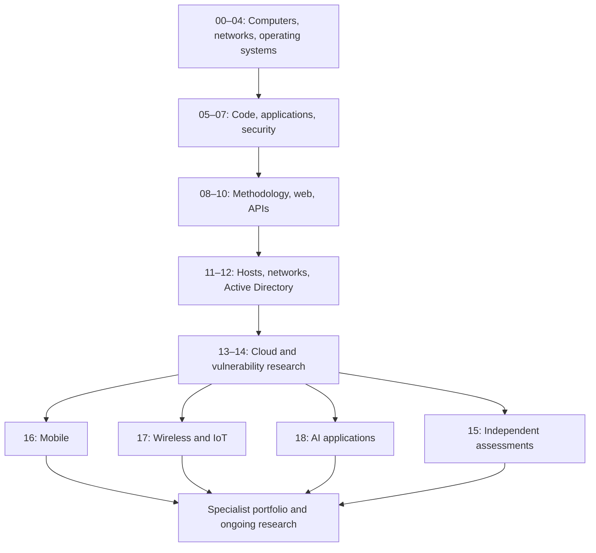
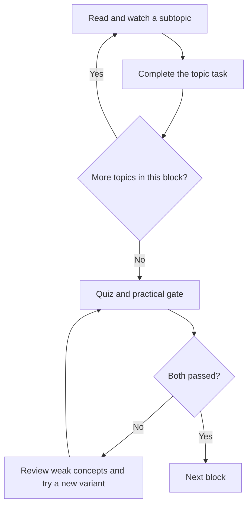

# Ethical Hacking & Penetration Testing: From Zero to Advanced Practice

**A prerequisite-led roadmap, practical workbook, and assessment guide**  
Prepared: **9 October 2026** · Entry requirement: **no prior technical knowledge**  
Format inspired by [roadmap.sh][ROADMAP] and the supplied `cyber-security-roadmap.pdf`; curriculum, exercises, sequencing, assessment questions, and rubrics are original.

## What this roadmap is designed to achieve

Learn to understand unfamiliar systems, form testable security hypotheses, identify and validate vulnerabilities in authorized environments, explain their impact, and help owners fix them. The destination is an independent penetration tester with a broad foundation and growing depth in selected specialties. No course makes someone capable of compromising every system. Advanced practitioners know how to investigate what they do not yet understand, recognize uncertainty, and work within scope.

The reference roadmap uses a central progression, connected topic boxes, side branches, and resource lists. This version preserves that structure while adding explicit prerequisites, nested learning objectives, paired reading/video resources, practice after every topic, and gates between blocks. Programming appears before substantial exploitation; reporting begins before the final assessment; specialist branches follow their prerequisites.

**All testing in this workbook is on your own isolated lab, a challenge provider's designated targets, or a system covered by explicit written authorization.** A publicly reachable service, a free account, or a company you work for is not by itself authorization to test it. The scope and lab controls in Block 00 are part of the technical workflow.

## Navigation

- [How to use the roadmap](#how-to-use-the-roadmap)
- [The route and estimated effort](#the-route-and-estimated-effort)
- [Free-resource and lab access guide](#free-resource-and-lab-access-guide)
- [00 - Orientation and safe practice](#b00)
- [01 - Computer literacy and lab setup](#b01)
- [02 - Networking](#b02)
- [03 - Linux administration](#b03)
- [04 - Windows and PowerShell](#b04)
- [05 - Programming and automation](#b05)
- [06 - Build and understand web applications](#b06)
- [07 - Security foundations](#b07)
- [08 - Penetration-testing methodology](#b08)
- [09 - Core web vulnerabilities](#b09)
- [10 - Advanced web and API testing](#b10)
- [11 - Host and network penetration testing](#b11)
- [12 - Active Directory and identity attack paths](#b12)
- [13 - Cloud, containers, and delivery pipelines](#b13)
- [14 - Reverse engineering and vulnerability research](#b14)
- [15 - Professional engagements and final capstones](#b15)
- [16 - Mobile specialization](#b16)
- [17 - Wireless and IoT specialization](#b17)
- [18 - AI application security specialization](#b18)
- [Certification milestones and remaining gaps](#certification-milestones-and-remaining-gaps)
- [Reusable templates](#reusable-templates)
- [Resource selection, access limitations, and maintenance](#resource-selection-access-limitations-and-maintenance)

## How to use the roadmap

1. Follow Blocks **00–15 in order**. Finish a block's topics from top to bottom. The prerequisites in specialist Blocks 16–18 allow you to branch earlier, but they do not replace the core.
2. Each topic has three numbered subtopic rows. Text after `→` gives the nested concepts within that subtopic. **Both resource cells apply to every nested concept in that row**; use the named chapter or lesson. Some require two complementary readings/videos. Reusing a course is intentional: you are building a coherent foundation rather than collecting hundreds of unrelated tutorials.
3. Read first, watch the specified lesson, and reproduce its ideas in your own notes. A course index is used where it provides named lessons or embedded recordings. You do not need to watch the entire course every time it appears.
4. Finish the **topic task** before moving down. Keep the stated deliverables. Challenges are learning activities, not just flag collection: record the cause, evidence, limitations, fix, and successful retest.
5. At the end of every block, complete the **checkpoint quiz and practical gate**. Do not read its answer key until you have written your answers.
6. Revisit one earlier exercise each week without its walkthrough. Keep a list of mistakes and the evidence that corrected them.

### Universal checkpoint rules

- Every checkpoint has **six original short-answer questions**. Score each **0** = incorrect/missing, **1** = partly correct, **2** = correct with a sound explanation. Pass at **10/12**, with no zero on a scope/isolation question.
- The practical gate has **four criteria, each worth 0–5**: 0 absent, 1 copied or substantially incorrect, 2 incomplete, 3 works with meaningful gaps, 4 correct and reproducible, 5 correct with a justified limitation or independent retest. Pass at **16/20**, with no criterion below 3.
- Scope violations, exposing a deliberately vulnerable target beyond the lab, or presenting fabricated evidence are automatic practical failures. Correct the problem and repeat the assessment.
- **First attempt:** personal notes and official documentation are allowed; walkthroughs, answer keys, and AI-generated solutions are not. During study, use AI for explanations, then verify against documentation. Never upload real credentials, client data, or exam material.
- For an exercise you had to look up, mark it **assisted**, explain the missed concept, and solve a different equivalent exercise unaided. Repeating memorized commands is not an independent pass.
- Failure loop: identify the weak subtopic → redo its task → wait until the next study session → attempt a fresh variant → update the gate score. Calendar dates never override a failed gate.

### A sustainable study session

For a two-hour session: 15 minutes recall, 30 minutes reading/video, 60 minutes hands-on work, 15 minutes notes and retest planning. Budget approximately half your total time for practice. Early tasks may take several sessions. If stuck for 45–60 focused minutes, write the current hypothesis and failed evidence before requesting a small hint.

## The route and estimated effort

These are planning estimates for an absolute beginner, including exercises and rework, not provider promises. Optional full courses and repeated failed assessments add time.

| Block | Learning destination | Estimated focused hours | Required before entry |
|---|---|---:|---|
| 00 | Scope, learning workflow, evidence habits | 8–12 | None |
| 01 | Computer literacy and isolated virtual machines | 35–55 | Gate 00 |
| 02 | Explain and troubleshoot network communication | 70–100 | Gate 01 |
| 03 | Operate and administer Linux | 60–90 | Gate 02 |
| 04 | Operate Windows and automate with PowerShell | 50–80 | Gate 03 |
| 05 | Write, debug, and test useful scripts | 100–150 | Gate 04 |
| 06 | Build a small web application and API | 70–110 | Gate 05 |
| 07 | Reason about security controls and risk | 50–75 | Gate 06 |
| 08 | Run a repeatable assessment process | 60–90 | Gate 07 |
| 09 | Manually test common web weaknesses | 110–160 | Gate 08 |
| 10 | Test advanced web flows and APIs | 130–190 | Gate 09 |
| 11 | Assess hosts, escalate lab privileges, and pivot | 110–170 | Gate 10 |
| 12 | Assess Active Directory identity paths | 130–190 | Gate 11 |
| 13 | Assess cloud identities, containers, and pipelines | 100–160 | Gate 12 |
| 14 | Analyze programs and research vulnerabilities | 160–240 | Gate 13 |
| 15 | Deliver independent professional assessments | 100–150 | Gate 14 |
| 16 | Mobile applications — specialist branch | 70–120 | Gates 10 and 14 |
| 17 | Wireless and IoT — specialist branch | 70–120 | Gates 11 and 14 |
| 18 | AI applications — specialist branch | 50–90 | Gates 10 and 13 |

Core total: **1,343–2,022 hours**. At 15 focused hours/week, approximately **21–31 months**; at 25 hours/week, approximately **12–19 months**, before holidays or major rework. You can become useful in supervised junior work before completing the research and specialist stages. Mastery continues through real engagements and feedback.



Within every block:



## Free-resource and lab access guide

**Free learning does not mean free certification or zero hardware cost.** No paid course subscription is required for the main reading/video assignments. Commercial certification paths are optional and described separately.

| Resource family | Free access and restrictions | How it is used |
|---|---|---|
| [Harvard CS50][CS50X], [MIT Missing Semester][MIT], [Professor Messer][MESSERN] | Public lessons/videos. Paid verified certificates, notes, downloads, or practice products are optional. CS50 submissions may require accounts. | Structured foundations; use public courseware and online videos. |
| [Cisco Networking Academy][CISCO] | Selected foundational courses are free; account required for enrollment and Packet Tracer access. | Computer/network lessons and simulations. |
| [PortSwigger Academy][PS] | Free reading and hosted labs; account for progress. Community Edition is sufficient for many labs; some workflows assume Pro features. | Use manual/non-Pro-compatible labs; local alternatives are specified for paid-feature dependencies. |
| [Hacker101][H101], [CyLab Security Academy][CYLAB], [pwn.college][PWN], [OverTheWire][BANDIT] | Free learning/challenges; account or SSH client as applicable. Provider-designated environments only. | Progressive practice and unfamiliar problems. |
| [APISec University][APIUNI], [OST2][OST], [BloodHound Basics][BHCOURSE] | Free selected courses; enrollment may be required. Optional paid offerings are outside this curriculum. | API, binary-analysis, and identity instruction. |
| [Juice Shop][JUICE], [WebGoat][WEBGOAT], [DVWA][DVWA], [crAPI][CRAPI] | Free local applications; your computer supplies the compute. | Repeatable app testing, fixes, and retests. |
| [GOAD][GOAD] | Open-source lab setup. Windows guests need valid licenses or official time-limited evaluations; hardware/storage requirements apply. | Active Directory practice. Start with the project's smaller lab option. |
| Cloud platforms | Documentation/videos are free. Account creation, resources, labs, and optional models can incur charges; “free tier” is not a spending cap. | Default to offline policy reviews and local containers. Live-cloud work is optional and labeled. |
| Mobile and wireless | Android emulators and supplied captures enable much free practice. iOS device/macOS access and compatible Wi-Fi adapters may cost money. | Do not buy hardware until the relevant branch. |

**Hardware plan:** a modern 64-bit laptop with 16 GB RAM can support a useful beginner lab by running only the necessary guests. Reserve roughly 80–150 GB of available storage initially, then reassess before AD/mobile work. Larger AD environments are more comfortable with 32 GB+ RAM and more disk. These are planning allowances, not universal minimums. Confirm the chosen lab's current requirements and guest architecture. On ARM hosts, use compatible guests or hosted challenges; do not assume every x86 VM will run.

**Lab network:** use an internal virtual network for vulnerable targets and the testing VM. A host-only network also exposes the target to the host, so treat that as a deliberate choice. Do not bridge vulnerable targets onto home/work Wi-Fi. A NAT guest can often initiate outbound connections; NAT alone is not complete isolation. Use a separate update state, then remove outbound connectivity before practice. Disable unneeded shared folders, clipboard sharing, and port forwarding. Containers belong inside the lab VM where practical; binding to `0.0.0.0` can expose them beyond localhost.

---

<a id="b00"></a>
## Block 00 — Orientation, authorization, and learning habits

**Outcome:** explain what a penetration test is and create the records needed to practice responsibly. Learn concepts here; install the lab in Block 01.

### 00.1 — Understand the job and its boundaries

- [ ] Complete topic 00.1 and save its task deliverable.

| Subtopic and nested concepts | Free reading | Free video |
|---|---|---|
| 00.1.1 Roles → ethical hacking, penetration testing, vulnerability assessment, bug bounty, red/blue/purple teams | [NIST: assessment approaches][NIST115] | [Hacker101: Pentesting vs Bug Bounty][H101PENTEST] |
| 00.1.2 Authorization → asset owner, scope, exclusions, test window, emergency stop, third-party dependencies | [NIST: planning and rules of engagement][NIST115] | [Hacker101: Starter's Guide to Pentesting][H101PENTEST] |
| 00.1.3 Professional conduct → minimum evidence, synthetic data, confidentiality, coordinated reporting, cleanup | [OWASP WSTG: introduction and reporting][WSTG] | [Hacker101: Reporting and Best Practices][H101PENTEST] |

**Topic task:** write a one-page authorization sheet for a fictional company, Cedar Lab. Name two permitted lab assets, two exclusions, permitted techniques, a stop contact, test dates, evidence storage, and cleanup requirements. Classify ten imaginary actions as permitted, prohibited, or needing clarification; explain each. Include a third-party login provider and an unexpected public IP among the cases.

### 00.2 — Learn how to learn and record evidence

- [ ] Complete topic 00.2.

| Subtopic and nested concepts | Free reading | Free video |
|---|---|---|
| 00.2.1 Technical reading → documentation, versions, examples, terminology, checking assumptions | [MIT: course overview and shell documentation][MITSHELL] | [MIT: course overview recording][MITSHELL] |
| 00.2.2 Working notes → timestamp, hypothesis, action, observation, conclusion, next test | [WSTG: reporting structure][WSTG] | [TCM Part 1: Effective Notekeeping, 27:44][TCM1] |
| 00.2.3 Evidence quality → reproducibility, negative results, redaction, distinguishing observation from inference | [WSTG: reporting][WSTG] | [Hacker101: Writing Good Reports][H101NEW] |

**Topic task:** create a private notebook with a glossary, daily log, lab inventory, findings, and mistakes section. Document a harmless action such as changing a display setting, including before/after evidence and reversal. Ask another person, or your future self after a day, to repeat it from the notes alone.

### 00.3 — Understand the practice environment

- [ ] Complete topic 00.3.

| Subtopic and nested concepts | Free reading | Free video |
|---|---|---|
| 00.3.1 Lab types → hosted CTF, local VM, container, purpose-built vulnerable application | [pwn.college: getting started/dojos][PWN] | [TCM Part 1: tools and VM setup, 34:27 and 1:46:01][TCM1] |
| 00.3.2 Isolation → host versus guest, internal versus NAT networking, shared folders, snapshots | [Oracle VirtualBox: networking chapter][VBOXNET] | [Messer A+ Core 1: Virtualization Concepts/Services][MESSERA1] |
| 00.3.3 Learning progression → guided task, independent attempt, hints, proof, remediation, retest | [Bandit: instructions and beginner guidance][BANDIT] | [Hacker101: introduction][H101NEW] |

**Topic task:** draw the proposed lab with a host, testing VM, vulnerable VM, update connection, and disconnected home/work network. Write how you will restore it and how you will prove isolation. Create an evidence checklist for a completed challenge; do not deploy vulnerable software yet.

### Checkpoint 00 — Permission and practice plan

**Original quiz:**

1. A company publishes its IP address. What additional condition must be met before you test it?
2. How does a penetration test differ from simply running a vulnerability scanner?
3. A permitted application redirects to an external identity provider. What should you do?
4. What is the difference between an observation and a hypothesis? Give an example.
5. Why is a VM snapshot useful, and what does it not replace?
6. Why should you record unsuccessful tests?

<details><summary>Answer key — open after attempting</summary>

1. Explicit authorization from an appropriate owner and scope covering the asset and proposed actions; visibility alone grants nothing.
2. A test uses a defined scope, manual validation, impact analysis, and reporting; a scanner provides candidate findings, including mistakes.
3. Stop at that boundary unless the separate service is explicitly authorized; clarify with the owner.
4. “The response is 403” is an observation; “the role check caused it” is a hypothesis that needs a controlled test.
5. It enables rollback of guest state; it does not replace independent backups, isolation, or evidence records.
6. They show coverage, prevent repeated dead ends, and constrain conclusions about what was actually tested.

</details>

**Practical gate:** submit the Cedar Lab authorization sheet, diagram, notebook sample, and ten scope decisions. Score: **scope completeness / isolation reasoning / reproducible notes / correct boundary decisions**. Pass using the universal rules before installing the practice lab.

---

<a id="b01"></a>
## Block 01 — Computer literacy and an isolated lab

**Outcome:** use a computer confidently and explain what is happening when software runs. Do not begin with attack tools.

### 01.1 — Hardware, data, and operating systems

- [ ] Complete topic 01.1.

| Subtopic and nested concepts | Free reading | Free video |
|---|---|---|
| 01.1.1 Components → CPU, cores, RAM, storage, network adapter, peripherals, firmware | [Cisco: Computer Hardware Basics][CISCOHW] | [Messer A+ Core 1: memory, storage, CPU, BIOS][MESSERA1] |
| 01.1.2 Data representation → bits/bytes, binary/decimal/hex, text encodings, file types, compression | [CS50x Week 0: notes][CS50X0] | [CS50x Week 0: lecture][CS50X0] |
| 01.1.3 Execution → OS, kernel, application, process, service, driver, boot sequence | [Cisco: Operating Systems Basics][CISCOOS] | [Messer A+ Core 2: Operating Systems][MESSERA2] |

**Topic task:** inventory your CPU, architecture, RAM, free storage, OS version, and network adapter without opening the chassis. Convert five small values between binary, decimal, and hexadecimal; distinguish MB from Mb. Open an application, identify its process, and explain which components retain data after shutdown.

### 01.2 — Everyday technical fluency

- [ ] Complete topic 01.2.

| Subtopic and nested concepts | Free reading | Free video |
|---|---|---|
| 01.2.1 Files → paths, folders, extensions, hidden files, copy/move/delete, archives, permissions | [Cisco: operating-system file management][CISCOOS] | [Messer A+ Core 2: Windows tools and file systems][MESSERA2] |
| 01.2.2 Software → browser versus internet, URL, download, install, update, uninstall, trusted source | [MDN: getting started and environment setup][MDNLEARN] | [Messer A+ Core 2: application installation and browser security][MESSERA2] |
| 01.2.3 Troubleshooting → exact error, recent change, one-variable test, log, backup, restore | [Cisco: OS troubleshooting][CISCOOS] | [Messer A+ Core 1: Troubleshooting Hardware/Networks][MESSERA1] |

**Topic task:** create a folder tree, save a text file, show its extension, archive it, restore a deleted copy from your own backup, and compare contents. Install and remove a benign application from its official source. Reproduce a missing-file error and document a diagnosis using evidence rather than repeated random changes.

### 01.3 — Virtual machines and recovery

- [ ] Complete topic 01.3.

| Subtopic and nested concepts | Free reading | Free video |
|---|---|---|
| 01.3.1 Virtualization → hypervisor, guest image, ISO, virtual CPU/RAM/disk, architecture compatibility | [VirtualBox manual: first steps][VBOX] | [Messer A+ Core 1: Virtualization Concepts/Services][MESSERA1] |
| 01.3.2 Networking → internal network, host-only, NAT, bridged, port forwarding, interface selection | [VirtualBox: networking modes][VBOXNET] | [TCM Part 1: VM installation/configuration][TCM1] |
| 01.3.3 Recovery → snapshots, guest updates, clean baseline, export, independent backup, disk capacity | [VirtualBox: snapshots and virtual storage][VBOX] | [Messer A+ Core 2: backup and recovery][MESSERA2] |

**Topic task:** install a supported Ubuntu guest from its official image and make a clean snapshot. Add a second benign guest when resources permit. Place them on an internal network, document their interfaces, and verify connectivity only where intended. Make a harmless configuration change and restore the snapshot. Keep vulnerable images uninstalled until you can explain the network settings.

### Checkpoint 01 — Rebuildable workstation

**Original quiz:**

1. Why does adding disk space not necessarily fix a machine running out of RAM?
2. What does an operating system provide that an ordinary application does not?
3. Is renaming `picture.jpg` to `picture.txt` a conversion? Explain.
4. Which two machines are meant by “host” and “guest”?
5. Why is NAT alone insufficient to guarantee a vulnerable guest cannot reach other systems?
6. What must you record so another learner can recreate your VM?

<details><summary>Answer key</summary>

1. RAM holds active working data; disk capacity is a different resource. Paging may help capacity but can be much slower.
2. It manages hardware, processes, memory, files, and access between programs and devices.
3. No. The bytes and format stay the same; only the name changes.
4. The host runs the hypervisor; the guest is the OS inside a virtual machine.
5. NAT commonly permits outbound traffic and may have port forwards; verify routes and interfaces and use stronger lab separation.
6. Image/source and version, architecture, virtual resources, network mode, setup steps, and recovery/verification procedure.

</details>

**Practical gate:** rebuild a guest from your instructions, recover a file, demonstrate snapshot rollback, and explain its connectivity. Score: **working rebuild / data recovery / isolation verification / hardware-and-OS explanation**.

---

<a id="b02"></a>
## Block 02 — Networking from first principles

**Outcome:** explain a request from application to destination, interpret packets, and troubleshoot connectivity.

### 02.1 — Devices, layers, and local networks

- [ ] Complete topic 02.1.

| Subtopic and nested concepts | Free reading | Free video |
|---|---|---|
| 02.1.1 Physical/link layers → Ethernet, Wi-Fi, MAC address, frame, switch, access point | [Cisco Networking Basics: networks and Ethernet][CISCONET] | [Messer Network+: networking devices and OSI model][MESSERN] |
| 02.1.2 Packet forwarding → router, gateway, routing table, ARP, broadcast domain, VLAN | [Cisco Networking Basics: local communication and routing][CISCONET] | [Messer Network+: routing, switching, VLANs][MESSERN] |
| 02.1.3 Layer models → OSI versus TCP/IP, encapsulation, header/payload, MTU, fragmentation | [Cisco Networking Basics: protocols and models][CISCONET] | [Messer Network+: OSI and IP packet concepts][MESSERN] |

**Topic task:** in [Packet Tracer][CISCO] or a drawn simulation, connect two hosts through a switch and then connect two networks through a router. Trace the MAC/IP changes at each hop. Explain why a VLAN needs appropriate routing/firewall policy to communicate with another VLAN. Save a labeled diagram and three packet-flow explanations.

### 02.2 — Addressing and transport

- [ ] Complete topic 02.2.

| Subtopic and nested concepts | Free reading | Free video |
|---|---|---|
| 02.2.1 IPv4 → private/public, subnet mask, CIDR, network/broadcast, loopback, default route | [Cisco Networking Basics: IPv4 and segmentation][CISCONET] | [TCM Part 1: addressing and subnetting, 41:06/1:14:39][TCM1] |
| 02.2.2 IPv6 and translation → notation, link-local, neighbor discovery, dual stack, NAT/PAT | [Cisco Networking Basics: IPv6][CISCONET] | [Messer Network+: IPv6 and network address translation][MESSERN] |
| 02.2.3 Transport → TCP handshake, sequence/acknowledgment, UDP, ports, sockets, ICMP | [pwn.college: communication lectures/slides][PWNCOMM] | [Messer Network+: TCP, UDP, and protocol fundamentals][MESSERN] |

**Topic task:** solve ten subnetting problems, including `/24`, `/26`, `/27`, and `/30`; calculate network, usable range, and broadcast for ordinary IPv4 LAN subnets. Identify IPv6 addresses on your guest. Capture one TCP connection and one UDP exchange. Explain why “a UDP port did not answer” does not prove it is closed.

### 02.3 — Network services and encrypted communication

- [ ] Complete topic 02.3.

| Subtopic and nested concepts | Free reading | Free video |
|---|---|---|
| 02.3.1 Naming/configuration → DNS records A/AAAA/CNAME/MX/TXT, resolver/cache/TTL, DHCP lease, NTP | [Cisco Networking Basics: application services][CISCONET] | [Messer Network+: DNS, DHCP, NTP][MESSERN] |
| 02.3.2 Application protocols → HTTP/HTTPS, SSH/SFTP, SMTP, SMB, RDP, LDAP; service versus port number | [Nmap: services and version detection][NMAP] | [Messer Network+: common ports and protocols][MESSERN] |
| 02.3.3 Trust and boundaries → TLS certificate/hostname, VPN tunnel, proxy, firewall, segmentation | [MDN: HTTP and transport security][MDNHTTP] | [Messer Network+: security concepts and remote access][MESSERN] |

**Topic task:** resolve a domain you own or an ordinary public documentation site using normal DNS queries; identify record types and TTLs. Inspect that site's TLS certificate in the browser. For your lab only, map five services to transport and observed port, then explain why moving SSH to a different port does not change its protocol.

### 02.4 — Troubleshooting and packet analysis

- [ ] Complete topic 02.4.

| Subtopic and nested concepts | Free reading | Free video |
|---|---|---|
| 02.4.1 Diagnostic tools → interface state, route, ping, traceroute, DNS lookup, socket listing | [Cisco Networking Basics: troubleshooting][CISCONET] | [TCM Part 1: common network commands, 2:45:21][TCM1] |
| 02.4.2 Capture skills → interface choice, capture/display filters, conversations, streams, timestamps | [Wireshark User's Guide: capture and display filters][WIRESHARK] | [Wireshark: SharkFest training recordings][SHARKFEST] |
| 02.4.3 Failure analysis → DNS failure, TCP refusal versus timeout, retransmission, TLS failure, asymmetric path | [Wireshark User's Guide: analyzing packets][WIRESHARK] | [Messer Network+: troubleshooting methodology and issues][MESSERN] |

**Topic task:** use only your own generated traffic or [Wireshark sample captures][PCAPS]. Annotate a DNS exchange and TCP handshake. Introduce three reversible lab faults: bad DNS setting, closed service, and blocked lab port. Identify each using a different observable symptom. Save capture files and a short troubleshooting decision tree.

### Checkpoint 02 — Explain the packet journey

**Original quiz:**

1. What does a switch normally use to forward an Ethernet frame? What does a router use?
2. For `192.168.10.70/26`, give network, ordinary usable range, and broadcast.
3. A hostname fails but an IP connection works. What is one reasonable hypothesis and test?
4. Does an open TCP port prove that a service is vulnerable?
5. What does TLS protect, and what does it not establish about application authorization?
6. Why can a machine that ignores ping still provide a working web service?

<details><summary>Answer key</summary>

1. Destination MAC and its forwarding table; destination IP and the routing table respectively.
2. Network `.64`, usable `.65–.126`, broadcast `.127` in `192.168.10.0/24`.
3. DNS resolution may be wrong; inspect resolver configuration and compare the name's answer with the intended IP.
4. No. It indicates a listener; vulnerability requires further evidence of a weakness under relevant conditions.
5. It protects transport confidentiality/integrity and supports endpoint authentication; it does not decide which records a logged-in user may access.
6. ICMP may be filtered while TCP/HTTPS is allowed; different protocols have different policies.

</details>

**Practical gate:** deliver a two-subnet diagram, ten correct subnet calculations after corrections, annotated captures, and diagnosis of three faults. Score: **addressing / packet interpretation / systematic troubleshooting / correct trust-boundary explanation**. Network+ preparation becomes plausible later after the certification gap checklist.

---

<a id="b03"></a>
## Block 03 — Linux administration and the command line

**Outcome:** understand the operating system beneath the tools. Use Ubuntu first; introduce Kali as a toolbox after you can manage a normal Linux guest.

### 03.1 — Files, shell, and text processing

- [ ] Complete topic 03.1.

| Subtopic and nested concepts | Free reading | Free video |
|---|---|---|
| 03.1.1 Navigation → absolute/relative path, home/root, file types, dotfiles, manual/help, editor | [Ubuntu command-line tutorial][UBUNTUCLI] | [MIT: Introduction to the Shell][MITSHELL] |
| 03.1.2 Composition → stdin/stdout/stderr, redirection, pipes, quoting, globbing, exit status | [The Linux Command Line: shell chapters][TLCL] | [MIT: shell and scripting lectures][MITSHELLSCRIPT] |
| 03.1.3 Text → grep, sort, uniq, cut, find, regular-expression basics, structured versus plain text | [The Linux Command Line: text processing][TLCL] | [MIT: Data Wrangling][MITDATA] |

**Topic task:** complete [Bandit][BANDIT] levels 0–10 and the corresponding [Linux Luminarium][LUMINARIUM] paths, commands, and piping exercises. Analyze a synthetic log: count events, extract unique addresses, and separate errors. Explain every command and quote a filename containing spaces correctly. Do not publish challenge passwords.

### 03.2 — Users, permissions, and processes

- [ ] Complete topic 03.2.

| Subtopic and nested concepts | Free reading | Free video |
|---|---|---|
| 03.2.1 Identity → UID/GID, users/groups, root, sudo, least privilege, file ownership | [The Linux Command Line: permissions][TLCL] | [TCM Part 1: users and privileges, 2:28:22][TCM1] |
| 03.2.2 Access → read/write/execute, directory semantics, octal modes, umask, ACL awareness, special bits | [Linux Luminarium: users and permissions][LUMINARIUM] | [pwn.college: Access Control lectures][PWNACCESS] |
| 03.2.3 Processes → PID/parent, jobs, signals, environment/PATH, service accounts, scheduled jobs | [The Linux Command Line: processes and environment][TLCL] | [MIT: command-line environment][MITENV] |

**Topic task:** create two unprivileged users and a shared group. Build a directory where one user can edit and another can only read; test as both users. Start a harmless long-running process, inspect its parent/environment, stop it, and explain the result. Solve six permissions or process challenges in Linux Luminarium.

### 03.3 — Services, packages, and observability

- [ ] Complete topic 03.3.

| Subtopic and nested concepts | Free reading | Free video |
|---|---|---|
| 03.3.1 Maintenance → repositories, package signatures, dependencies, service management, updates | [Kali Linux Revealed: package management and services][KALIBOOK] | [TCM Part 1: services and installing/updating, 3:00:16–3:18:35][TCM1] |
| 03.3.2 Remote access → SSH host keys, user keys, file transfer, listening address, firewall | [Kali Linux Revealed: securing and monitoring Linux][KALIBOOK] | [MIT: command-line environment, remote machines][MITENV] |
| 03.3.3 Logs and recovery → journal/syslog, authentication events, disk/memory use, backups, time zones | [Kali Linux Revealed: administration/monitoring][KALIBOOK] | [MIT: debugging/profiling and machine inspection][MITDEBUG] |

**Topic task:** install a benign local service, restrict it to the intended interface, inspect its listener and logs, and connect with SSH keys between your own guests. Deliberately stop the service and diagnose the failure. Restore a configuration backup. Finish Bandit 11–20, with notes about encodings and archives rather than pasted solutions.

### Checkpoint 03 — Operate without a walkthrough

**Original quiz:**

1. Why can a user read a file but still fail to access it through a directory?
2. What does `sudo` change about a command's execution?
3. Why can a tool available in one terminal be “not found” in another?
4. How do stderr and an exit status differ?
5. What risk does accepting an unexpected SSH host-key change create?
6. A service has stopped. What evidence should you collect before reinstalling it?

<details><summary>Answer key</summary>

1. Traversing directories requires appropriate execute/search permission along the path, in addition to the file's permissions.
2. It runs the permitted command under another identity, usually root, according to policy; it is not a universal requirement.
3. PATH, environment, shell initialization, working directory, or installed environment may differ.
4. stderr carries diagnostic text; exit status is a process result code. Either can exist without a useful message in the other.
5. You might trust an impersonating host; verify the legitimate host's fingerprint through a trusted channel.
6. Status, recent logs, configuration validity, resource use, dependencies, and recent changes; preserve the error before changing state.

</details>

**Practical gate:** from a clean guest, build the two-user permission model, install/restrict a service, diagnose a planted failure, and restore it. Score: **shell fluency / access correctness / evidence-led diagnosis / recovery**.

---

<a id="b04"></a>
## Block 04 — Windows, PowerShell, and endpoint internals

**Outcome:** administer and inspect a Windows lab without confusing local accounts, administrator rights, and domain identities.

### 04.1 — Windows structure and access

- [ ] Complete topic 04.1.

| Subtopic and nested concepts | Free reading | Free video |
|---|---|---|
| 04.1.1 Administration → editions, updates, services, Registry, scheduled tasks, local accounts/groups | [Microsoft Windows documentation][WINDOC] | [Messer A+ Core 2: Windows tools and configuration][MESSERA2] |
| 04.1.2 Authorization → SID, security token, NTFS permissions, ACL inheritance, UAC, standard/admin account | [Microsoft: Access Control Overview][WINACCESS] | [Messer A+ Core 2: Windows security settings][MESSERA2] |
| 04.1.3 Network access → SMB shares versus NTFS access, RDP, firewall profiles, local versus domain login | [Microsoft: Windows Server networking][WINNETWORK] | [Messer A+ Core 2: networking and remote access][MESSERA2] |

**Topic task:** in a licensed/evaluation guest, create standard and administrator accounts. Set a test folder's ACL and a local share, then compare effective access for two users. Inspect a service and a scheduled task. Document an allowed and denied operation without disabling the system's protections.

### 04.2 — PowerShell as an administration language

- [ ] Complete topic 04.2.

| Subtopic and nested concepts | Free reading | Free video |
|---|---|---|
| 04.2.1 Discoverability → Get-Help, Get-Command, cmdlet nouns/verbs, parameters, modules | [PowerShell 101: help and command discovery][PS101] | [Microsoft: Getting Started with PowerShell, discovery lessons][PSVIDEO] |
| 04.2.2 Object pipeline → properties, filtering, selection, sorting, formatting versus data | [PowerShell 101: objects and pipeline][PS101] | [Microsoft: PowerShell pipeline lessons][PSVIDEO] |
| 04.2.3 Scripts → variables, loops, functions, errors, CSV/JSON, execution-policy limitations | [PowerShell 101: scripting chapters][PS101] | [Microsoft: PowerShell scripting lessons][PSVIDEO] |

**Topic task:** write a read-only inventory script producing CSV/JSON for processes, services, local users, and basic network settings. Handle a missing permission without silently reporting empty results as success. Keep collection local. Explain why an execution-policy setting is not a complete security boundary.

### 04.3 — Processes and Windows evidence

- [ ] Complete topic 04.3.

| Subtopic and nested concepts | Free reading | Free video |
|---|---|---|
| 04.3.1 Runtime → process tree, command line, loaded modules, handles, service identity | [Microsoft Sysinternals: Process Explorer/Process Monitor][SYSINTERNALS] | [TCM Windows escalation: initial enumeration, 23:15][WINPRIVVIDEO] |
| 04.3.2 Event evidence → Event Viewer, authentication events, time correlation, auditing prerequisites | [Microsoft: Windows security auditing][WINAUDIT] | [Messer Security+: monitoring, log data, investigations][MESSERS] |
| 04.3.3 Protection → Defender, patching, disk encryption, firewall, recovery, baseline comparison | [Microsoft Windows Security][WINSEC] | [Messer A+ Core 2: endpoint protection and recovery][MESSERA2] |

**Topic task:** generate a successful and failed login in your guest, locate available events, and record which audit settings were required. Observe a benign program opening a file with Process Monitor. Produce a before/after baseline for one approved configuration change and restore it.

### Checkpoint 04 — Windows administration evidence

**Original quiz:**

1. Why might access through an SMB share fail even when NTFS permissions appear sufficient?
2. How is the PowerShell pipeline different from an ordinary text pipe?
3. Does membership in Administrators mean every process runs elevated?
4. What information can a process tree reveal that a filename alone cannot?
5. Why does the absence of a login event not prove no login occurred?
6. Why should a collection script distinguish “zero results” from “access denied”?

<details><summary>Answer key</summary>

1. Share permissions, identity, firewall/network policy, and NTFS permissions all matter; effective access depends on the actual path and identity.
2. Cmdlets commonly pass structured objects with properties, not only displayed strings.
3. No. UAC and token/elevation context affect the running process.
4. Parentage, command-line context, user identity, and related child activity support a more reliable interpretation.
5. Auditing may be disabled, logs may have rolled over, or the event may be elsewhere; check collection coverage.
6. Missing visibility is not evidence of absence. Reporting the error preserves the validity of the assessment.

</details>

**Practical gate:** deliver your inventory script, two-user access matrix, annotated process evidence, and login-event timeline. Score: **permissions / useful automation / event interpretation / recovery and limitations**.

---

<a id="b05"></a>
## Block 05 — Programming, automation, and reproducibility

**Outcome:** write and debug small tools, read unfamiliar code, and understand what a downloaded script will do before running it.

### 05.1 — Python fundamentals

- [ ] Complete topic 05.1.

| Subtopic and nested concepts | Free reading | Free video |
|---|---|---|
| 05.1.1 Building blocks → variables, types, strings/bytes, input/output, functions, scope | [CS50P: notes, weeks 0–1][CS50P] | [CS50P: lectures 0–1][CS50P] |
| 05.1.2 Control and data → conditions, loops, lists, tuples, dictionaries, sets, iteration | [CS50P: notes, weeks 1–2][CS50P] | [CS50P: lectures 1–2][CS50P] |
| 05.1.3 Reliability → exceptions, imports, standard library, virtual environments, dependency versions | [CS50P: weeks 3–4 notes][CS50P] and [Python tutorial][PYDOC] | [CS50P: exceptions and libraries][CS50P] |

**Topic task:** complete at least eight CS50P problems across these units. Write an address-book program using synthetic data with search, input validation, and graceful errors. Explain every line of a small unfamiliar Python script and predict its output before execution.

### 05.2 — Files, tests, and data handling

- [ ] Complete topic 05.2.

| Subtopic and nested concepts | Free reading | Free video |
|---|---|---|
| 05.2.1 Persistence → file paths, context managers, CSV/JSON, encodings, parsing, malformed input | [CS50P: File I/O notes][CS50P] | [CS50P: File I/O lecture][CS50P] |
| 05.2.2 Correctness → unit tests, assertions, boundary cases, logging, debugging, reproducible bugs | [CS50P: Unit Tests notes][CS50P] and [MIT debugging notes][MITDEBUG] | [CS50P: Unit Tests][CS50P] and [MIT debugging recording][MITDEBUG] |
| 05.2.3 Text models → regular expressions, escaping, bytes versus Unicode, basic classes and methods | [CS50P: regex and object-oriented notes][CS50P] | [CS50P: Regular Expressions and OOP][CS50P] |

**Topic task:** build a synthetic authentication-log analyzer with JSON output. Test empty files, malformed lines, different timestamps, and duplicate records. Include at least six meaningful tests and one deliberately broken test you then repair. Avoid counting a parsing failure as “no suspicious events.”

### 05.3 — HTTP and network scripting

- [ ] Complete topic 05.3.

| Subtopic and nested concepts | Free reading | Free video |
|---|---|---|
| 05.3.1 Networking code → socket, client/server, timeout, connection failure, text/byte conversion | [Python: socket documentation][PYSOCKET] | [TCM Part 1: sockets, 5:15:30][TCM1] |
| 05.3.2 HTTP clients → methods, status, headers, JSON, cookies, redirects, certificate verification | [Requests: Quickstart][REQUESTS] | [CS50 Web: Django and JavaScript requests][CS50WEB] |
| 05.3.3 Safe automation → explicit target list, rate cap, bounded retries, dry-run, errors, secrets outside code | [OWASP: REST Security and Secrets Management sheets][CHEATSHEETS] | [CS50 Web: Testing/CI and Scalability/Security][CS50WEB] |

**Topic task:** create a local HTTP health checker that accepts only a supplied list of your lab URLs, limits request rate, sets timeouts, and logs status/error separately. Reject an out-of-list destination and unexpected redirects. Use a tiny local server to test success, timeout, and error cases; no internet-wide scanning.

### 05.4 — Shell scripting and version control

- [ ] Complete topic 05.4.

| Subtopic and nested concepts | Free reading | Free video |
|---|---|---|
| 05.4.1 Bash → arguments, quoting, conditions, loops, return values, pipeline pitfalls | [MIT: shell tools and scripting][MITSHELLSCRIPT] | [MIT: corresponding recording][MITSHELLSCRIPT] |
| 05.4.2 Git → repository, commit, diff, branch, merge, restore, ignore files | [Pro Git: getting started and basics][GITBOOK] | [MIT: Version Control][MITGIT] |
| 05.4.3 Project hygiene → README, requirements, tests, reproducible setup, secret redaction, licensing | [MIT: code quality and packaging][MIT] | [MIT: code quality and packaging recordings][MIT] |

**Topic task:** version your log analyzer and health checker in a private local repository. Create and merge a branch, recover a previous revision, and reproduce setup in a clean environment. Add a README with inputs, outputs, limits, and tests. Use only dummy secrets; explain why deleting a secret from the latest file does not remove Git history.

### Checkpoint 05 — Build a dependable small tool

**Original quiz:**

1. How do bytes differ from a Unicode string when communicating over a socket?
2. Why can an HTTP timeout not be reported as status code 200?
3. What is one boundary case for a log parser, and why does it matter?
4. Why should a network tool have both a timeout and a request limit?
5. A password was committed and then deleted. Is the repository safe to share?
6. What makes a bug report reproducible?

<details><summary>Answer key</summary>

1. Sockets transfer bytes; strings require a defined encoding/decoding. Confusing them causes errors or data corruption.
2. No successful HTTP response was observed; report a connection/request error, not invented evidence.
3. Examples include empty input, malformed timestamps, or unexpected encoding; mishandling can distort conclusions or crash the tool.
4. A timeout bounds waiting per operation; a limit bounds workload and overall effect. Neither fully replaces the other.
5. Not necessarily: history may retain it. Rotate any real secret and review/remove exposure before sharing.
6. A minimal input, environment/version, exact steps, expected and actual result, and supporting evidence.

</details>

**Practical gate:** independently build a lab inventory/report generator combining a local file parser and bounded HTTP checker. Score: **correct outputs / error handling and tests / scope controls / documentation and clean rebuild**. Do not progress if you cannot explain your own code.

---

<a id="b06"></a>
## Block 06 — Build applications before testing them

**Outcome:** understand the browser, server, database, and identity boundaries that create application vulnerabilities.

### 06.1 — Browser and HTTP fundamentals

- [ ] Complete topic 06.1.

| Subtopic and nested concepts | Free reading | Free video |
|---|---|---|
| 06.1.1 Frontend → HTML elements/forms, basic CSS, JavaScript, DOM, event handlers, developer tools | [MDN: core HTML/CSS/JavaScript modules][MDNLEARN] | [CS50 Web: HTML/CSS and JavaScript][CS50WEB] |
| 06.1.2 Protocol → URL parts, methods, status codes, headers/body, content type, encoding, caching | [MDN: HTTP overview and messages][MDNHTTP] | [Hacker101: The Web in Depth][H101NEW] |
| 06.1.3 Browser state → cookies, session, local storage, origin/site distinction, same-origin policy, CORS | [MDN: HTTP cookies and CORS][MDNHTTP] | [Hacker101: web fundamentals][H101NEW] and [CS50 Web: security][CS50WEB] |

**Topic task:** build a small page with a form and JavaScript request to a local server. Inspect its request, response, cookie, and DOM in developer tools. Change a client-side field and explain why the server must still validate it. Draw the difference between a browser origin and a URL path.

### 06.2 — Server, SQL, and access decisions

- [ ] Complete topic 06.2.

| Subtopic and nested concepts | Free reading | Free video |
|---|---|---|
| 06.2.1 Backend → routes, request parsing, templates, configuration, exceptions, middleware | [Flask tutorial][FLASK] | [CS50x: Flask lecture][CS50X] |
| 06.2.2 Database → tables, primary/foreign keys, SELECT/INSERT/UPDATE/DELETE, joins, parameterization | [CS50 SQL: notes and practice][CS50SQL] | [CS50 SQL: Querying/Relating/Writing lectures][CS50SQL] |
| 06.2.3 Identity → registration/login/logout, password hashing, session lifecycle, role and ownership checks | [Flask tutorial: authentication][FLASK] and [OWASP Authentication sheet][CHEATSHEETS] | [CS50 Web: Django and security][CS50WEB] |

**Topic task:** build a local notes application with two ordinary users and one administrator. Each user can view/edit only their own notes. Use parameterized database access, a framework's password-hashing helper, and server-side authorization. Create tests for a normal request, another user's record, and an unauthenticated request.

### 06.3 — APIs, deployment, and trust boundaries

- [ ] Complete topic 06.3.

| Subtopic and nested concepts | Free reading | Free video |
|---|---|---|
| 06.3.1 APIs → JSON, REST resources, parameters, pagination, versioning, OpenAPI, GraphQL overview | [PortSwigger: API testing][PSAPI] and [GraphQL introduction][PSGRAPH] | [APISec University: API fundamentals][APIUNI] |
| 06.3.2 Deployment → reverse proxy, application server, database, environment secrets, TLS termination | [MDN: server-side introduction][MDNSERVER] | [CS50 Web: Scalability and Security][CS50WEB] |
| 06.3.3 Boundaries → browser/server, user/tenant, service/service, file upload/storage, logs/errors | [OWASP WSTG: architecture and threat modeling][WSTG] | [APISec University: API risks and authorization][APIUNI] |

**Topic task:** add a JSON API to your notes app, write a simple endpoint inventory, and draw a data-flow diagram with boundaries. Explain where validation and authorization occur. Test pagination, invalid types, and a second user's note ID. Keep the app reachable only in your lab.

### Checkpoint 06 — Explain your own application

**Original quiz:**

1. Why is hiding an administrator button insufficient access control?
2. How does a session cookie differ from the server-side session data it references?
3. What separates authentication from authorization?
4. Why are parameterized database queries safer than concatenating user input?
5. Can a frontend API key be treated as a secret? Why?
6. Why must an API check ownership even when object IDs are hard to guess?

<details><summary>Answer key</summary>

1. Clients can send requests without the interface; enforce permissions on the server for every relevant operation.
2. A cookie is browser-held data; in a server-side session design it often identifies state stored separately. Other session designs exist.
3. Authentication establishes identity; authorization decides permitted actions on specific resources.
4. Values are handled as data rather than changing query structure, when the API is used correctly.
5. Generally no: users can inspect delivered code/network traffic. Restrict public identifiers and keep actual secrets server-side.
6. Unpredictability is not authorization; leaked or discovered IDs must not grant access across users.

</details>

**Practical gate:** demonstrate the notes application and API, explain one full request's path, show cross-user denials, and rebuild from documentation. Score: **working system / correct identity boundaries / protocol-and-data explanation / tests and reproducibility**.

---

<a id="b07"></a>
## Block 07 — Security principles, cryptography, and defense

**Outcome:** explain why a weakness matters and how a control addresses it, rather than identifying tools by name.

### 07.1 — Security reasoning and threat modeling

- [ ] Complete topic 07.1.

| Subtopic and nested concepts | Free reading | Free video |
|---|---|---|
| 07.1.1 Core principles → confidentiality/integrity/availability, least privilege, defense in depth, secure defaults | [CS50 Cybersecurity: notes][CS50CYBER] | [CS50 Cybersecurity: Securing Systems][CS50CYBER] |
| 07.1.2 Risk → asset, threat, vulnerability, likelihood, impact, exposure, residual risk, false positives/negatives | [NIST CSF 2.0: framework and resources][NISTCSF] | [Messer Security+: risk and vulnerability management][MESSERS] |
| 07.1.3 Modeling → data flow, trust boundary, abuse case, attacker capability, assumption, control | [OWASP: Threat Modeling sheet][CHEATSHEETS] | [CS50 Cybersecurity: Securing Software][CS50CYBER] |

**Topic task:** threat-model the notes app. Identify five assets, five plausible abuse cases, controls, assumptions, and residual risk. For three alerts or findings, invent a true positive and false positive example. Explain how missing logs can create false confidence.

### 07.2 — Cryptography and identity foundations

- [ ] Complete topic 07.2.

| Subtopic and nested concepts | Free reading | Free video |
|---|---|---|
| 07.2.1 Representation versus protection → encoding, hashing, encryption, signing, checksums | [CS50 Cybersecurity: Securing Data notes][CS50CYBER] | [CS50 Cybersecurity: Securing Data][CS50CYBER] |
| 07.2.2 Cryptographic use → symmetric/asymmetric keys, random nonce/IV, authenticated encryption, key exchange, PKI | [pwn.college: cryptography slides and explanations][PWNCRYPTO] | [pwn.college: cryptography lectures][PWNCRYPTO] |
| 07.2.3 Identity controls → password KDF/salt, MFA, recovery, certificate validation, key storage/rotation | [OWASP: Password Storage and Key Management sheets][CHEATSHEETS] | [CS50 Cybersecurity: Securing Accounts and Data][CS50CYBER] |

**Topic task:** hash a harmless file before/after a one-byte change; encode and decode a string; compare the roles of hashing and encryption. Use a supported library/framework to hash two identical passwords with independent salts and verify them. Inspect a certificate chain. Complete three introductory [CryptoHack][CRYPTOHACK] challenges without inventing your own production cipher.

### 07.3 — Defenses and incident evidence

- [ ] Complete topic 07.3.

| Subtopic and nested concepts | Free reading | Free video |
|---|---|---|
| 07.3.1 Endpoint/network controls → patching, segmentation, firewalls, EDR, IDS/IPS, hardening, backups | [NIST CSF: Protect and Detect][NISTCSF] | [Messer Security+: architecture and mitigations][MESSERS] |
| 07.3.2 Detection → log source, event correlation, timestamps, baseline, alert, ATT&CK behavior mapping | [MITRE ATT&CK: enterprise matrix and techniques][ATTACK] | [Messer Security+: monitoring and threat hunting][MESSERS] |
| 07.3.3 Response → triage, containment, evidence preservation, recovery, lessons learned, tabletop | [NIST incident-response guidance SP 800-61 Rev. 3][NISTIR] | [Messer Security+: incident response and investigations][MESSERS] |

**Topic task:** correlate your own failed logins, firewall events, and application logs into a short timeline. Propose two detections with expected false positives. Run a tabletop involving a lost test credential: decide what to preserve, revoke, restore, and improve. Restore a backup and prove the restored data is usable.

### 07.4 — Governance, cloud, and modern risk literacy

- [ ] Complete topic 07.4.

| Subtopic and nested concepts | Free reading | Free video |
|---|---|---|
| 07.4.1 Governance → policy/standard/procedure, asset lifecycle, awareness, access reviews, vendor risk | [NIST CSF: Govern][NISTCSF] | [Messer Security+: governance and oversight][MESSERS] |
| 07.4.2 Cloud and resilience → IaaS/PaaS/SaaS, shared responsibility, continuity, recovery objectives | [AWS: shared responsibility][AWSSHARED] | [Messer Security+: cloud architecture and resilience][MESSERS] |
| 07.4.3 Human and AI risks → phishing/pretexting awareness, sensitive-data handling, AI tool permissions, untrusted output | [OWASP: AI Agent Security and data-handling sheets][CHEATSHEETS] and [CISA: recognize and report phishing][CISAPHISH] | [Messer Security+: social engineering][MESSERS] and [MSRC: AI red-teaming overview][PYRITVIDEO] |

**Topic task:** write a small-business control sheet covering account onboarding/offboarding, backup ownership, vendor access, and AI data use. Run a consent-based tabletop about a suspicious email; do not send deceptive messages. Explain who is responsible for a misconfigured cloud storage permission. Compare recovery time and acceptable data loss in your own words.

### Checkpoint 07 — Defend the system you built

**Original quiz:**

1. Give different examples of a threat, a vulnerability, and a risk for the notes app.
2. Why is Base64 unsuitable for protecting a password?
3. What does a password salt accomplish, and what does it not accomplish?
4. Why does MFA not fix a missing record-ownership check?
5. Who normally decides permissions on customer data stored in a cloud service?
6. Why should a backup be restored during testing rather than merely checked for existence?

<details><summary>Answer key</summary>

1. An unauthorized reader is a threat actor/capability; a missing ownership check is a vulnerability; confidential notes being exposed is a risk scenario.
2. It is reversible encoding with no secret key, not password storage protection.
3. Unique salts make identical passwords differ and hinder precomputed comparisons; they do not replace a slow password KDF or strong passwords.
4. MFA strengthens identity verification; the application must separately authorize access to each object.
5. Responsibility depends on the service, but customers commonly configure their identities and data access; the provider does not make every authorization decision for them.
6. Existence does not prove integrity, completeness, available keys, or a working restoration process within the required time.

</details>

**Practical gate:** deliver the threat model, working controls, restored backup, and incident tabletop record. Score: **risk reasoning / correct cryptographic choices / defense-and-recovery validation / clear communication**. You now have foundations for CC/Security+ preparation; use the current-objective gaps in the certification section.

---

<a id="b08"></a>
## Block 08 — A repeatable penetration-testing method

**Outcome:** move from a written scope to a defensible finding. Learn why and when to use a tool before relying on its output.

### 08.1 — Plan and model the engagement

- [ ] Complete topic 08.1.

| Subtopic and nested concepts | Free reading | Free video |
|---|---|---|
| 08.1.1 Engagement design → objectives, black/gray/white box, accounts, exclusions, stop conditions, communications | [NIST: planning and rules of engagement][NIST115] | [Hacker101: Pentesting vs Bug Bounty and best practices][H101PENTEST] |
| 08.1.2 Attack surface → asset inventory, service inventory, user roles, trust boundaries, dependencies | [WSTG: information gathering][WSTG] | [Hacker101: Starter's Guide to Pentesting with OWASP][H101PENTEST] |
| 08.1.3 Test planning → hypothesis, precondition, expected result, safe evidence, risk limit, cleanup | [WSTG: testing framework][WSTG] | [Hacker101: pentest methodology][H101PENTEST] |

**Topic task:** write a test plan for your notes app plus two lab hosts. Include a user-role matrix, asset list, time budget, excluded actions, and ten test hypotheses. Add a stop-and-notify procedure for unexpected sensitive data or an unintended service interruption. Do not include denial-of-service testing in the default scope.

### 08.2 — Reconnaissance and enumeration

- [ ] Complete topic 08.2.

| Subtopic and nested concepts | Free reading | Free video |
|---|---|---|
| 08.2.1 Passive research → owner-published information, DNS, certificate records, source provenance, scope ambiguity | [WSTG: information gathering tests][WSTG] | [TCM Part 1: passive recon, 6:27:52 onward][TCM1] |
| 08.2.2 Active discovery → reachable hosts, TCP/UDP states, service/version, timing, filtering, scan limitations | [Nmap reference: discovery, scan types, timing, output][NMAP] | [TCM Part 2: scanning and enumeration sections][TCM2] |
| 08.2.3 Application discovery → endpoints, parameters, technologies, content paths, roles, baseline responses | [WSTG: entry points and application mapping][WSTG] | [PortSwigger: getting-started Burp tutorials][PSSTART] |

**Topic task:** build an inventory from a local two-host network and your app. Compare Nmap results with the service configuration you control; explain discrepancies. Record three “unknown” observations without upgrading them into findings. Practice passive research on your own repository or fictional business documents, avoiding collection of strangers' personal data.

### 08.3 — Tools and vulnerability validation

- [ ] Complete topic 08.3.

| Subtopic and nested concepts | Free reading | Free video |
|---|---|---|
| 08.3.1 Interception → proxy scope, browser trust, HTTP history, Repeater, raw request editing, tool state | [Burp Community documentation][BURPDOC] | [PortSwigger: Burp video tutorials][PSSTART] |
| 08.3.2 Scanners → passive versus active, authenticated coverage, false positives, version/configuration dependence | [ZAP: getting started][ZAPDOC] | [ZAP: official getting-started/deep-dive videos][ZAPVIDEO] |
| 08.3.3 Research validation → CVE versus CWE, affected versions, vendor advisory, exploit prerequisites, source review | [CVE program overview][CVE] and [CWE weakness definitions][CWE] | [TCM Part 2: vulnerability research and exploitation demonstrations][TCM2] |

**Topic task:** intercept and replay a harmless request to your app. Run a restrained ZAP assessment of that app in the lab, validate three candidate observations manually, and document at least one false positive or unconfirmed result. Compare a vendor advisory against an intentionally vulnerable lab version; explain all conditions needed before any proof of concept could apply.

### 08.4 — Evidence, severity, and remediation

- [ ] Complete topic 08.4.

| Subtopic and nested concepts | Free reading | Free video |
|---|---|---|
| 08.4.1 Findings → title, affected asset, prerequisites, reproduction, evidence, observed impact, uncertainty | [WSTG: reporting][WSTG] | [Hacker101: Writing Good Reports][H101NEW] |
| 08.4.2 Severity → CVSS metrics/vector, technical severity versus business priority, scope of impact | [FIRST: CVSS v4 specification and examples][CVSS] | [Messer Security+: vulnerability analysis and prioritization][MESSERS] |
| 08.4.3 Closure → practical fix, owner, verification criteria, retest, residual risk, limitations, cleanup | [WSTG: analysis and reporting][WSTG] | [Hacker101: Pentest Reporting and Best Practices][H101PENTEST] |

**Topic task:** create three finding records: one validated weakness, one informational observation, and one rejected hypothesis. Give the validated weakness a defensible severity with assumptions, a fix, and a retest. Have a reader reproduce it using only the report. Do not label a version banner alone as confirmed exploitation.

### Checkpoint 08 — A small complete assessment

**Original quiz:**

1. What is the difference between recon and vulnerability validation?
2. A scanner reports a CVE based on a banner. What must you check next?
3. Why can authenticated testing reveal weaknesses missed by an unauthenticated scan?
4. What is a false positive? Give a plausible example.
5. Why can two businesses assign different priority to the same technical vulnerability?
6. What evidence belongs in a retest record?

<details><summary>Answer key</summary>

1. Recon discovers assets/behavior; validation tests a specific security hypothesis and its preconditions.
2. Actual version/build, patch backports, configuration, exposure, and safe reproduction against the affected condition.
3. Privileged features, role boundaries, and logged-in workflows may not be visible otherwise.
4. A reported weakness that is not present; for example a version-only alert where the vulnerable code was backport-patched.
5. Data sensitivity, exposure, business dependency, compensating controls, and threat context differ.
6. The changed version/configuration, repeated original test, negative/positive controls, result, date, and any remaining limitation.

</details>

**Practical gate:** assess your app and one lab service under a written scope; submit an inventory, test log, validated findings, and retest. Score: **coverage / validation quality / impact and remediation / reproducible report**.

---

<a id="b09"></a>
## Block 09 — Core web application vulnerabilities

**Outcome:** discover and explain common application flaws manually. For a video embedded under a lab's **Community solutions**, treat that lab as a demonstration. Attempt it first, then watch; use a different lab for your independent task count. Never count a watched solution as an unseen solve.

### 09.1 — Authentication, authorization, and sessions

- [ ] Complete topic 09.1.

| Subtopic and nested concepts | Free reading | Free video |
|---|---|---|
| 09.1.1 Authentication → enumeration, login/reset workflows, MFA logic, rate limiting, recovery, lockout risk | [PortSwigger: authentication][PSAUTH] | [Rana Khalil: Authentication Vulnerabilities][AUTHVIDEO] |
| 09.1.2 Authorization → horizontal/vertical access, IDOR, ownership, roles, methods, tenant isolation | [PortSwigger: access control][PSACCESS] | [Hacker101: XSS and Authorization][H101WEB] |
| 09.1.3 Sessions → fixation, expiration, logout, cookie attributes, state changes, session theft versus authorization | [WSTG: session management][WSTG] | [Hacker101: Session Fixation][H101WEB] and [Rana Khalil: authentication][AUTHVIDEO] |

**Topic task:** solve two independent authentication and three access-control labs in [PortSwigger][PS], then build a role/resource/action matrix for your own notes app. Verify logged-out, ordinary-user, other-user, and admin cases, including direct requests that bypass the UI. Test session invalidation after logout and write two complete findings. Use only deliberately weak lab accounts for bounded password-control experiments.

### 09.2 — Injection and filesystem boundaries

- [ ] Complete topic 09.2.

| Subtopic and nested concepts | Free reading | Free video |
|---|---|---|
| 09.2.1 SQL injection → query structure, error/union/blind behavior, parameterization, least-privileged DB identity | [PortSwigger: SQL injection][PSSQL] | [Rana Khalil: SQL Injection Complete Guide][SQLVIDEO] |
| 09.2.2 OS command injection → shell interpretation, argument injection, output/blind evidence, safe APIs | [PortSwigger: OS command injection][PSCMD] | [pwn.college: Web Security command-injection lectures][PWNWEB] |
| 09.2.3 Path traversal/inclusion → normalization, relative paths, file access, allowlists, read versus execution impact | [PortSwigger: path traversal][PSTRAV] and [WSTG: file-inclusion tests][WSTG] | [pwn.college: Web Security path-traversal lectures][PWNWEB] |

**Topic task:** complete four SQLi labs spanning observable and blind behavior, two command-injection labs, and two traversal labs. Use only the lab's designated proof data. Reproduce one bug in a disposable copy of your notes app, fix it, and show the same test fails while normal functionality still works. Explain the interpreted language at each boundary.

### 09.3 — Browser trust and client-side vulnerabilities

- [ ] Complete topic 09.3.

| Subtopic and nested concepts | Free reading | Free video |
|---|---|---|
| 09.3.1 XSS → reflected/stored/DOM, source/sink, output context, encoding, sanitization, CSP limitations | [PortSwigger: XSS and DOM vulnerabilities][PSXSS] | [Hacker101: XSS][H101WEB] and [pwn.college: Web Security lectures][PWNWEB] |
| 09.3.2 CSRF → ambient credentials, state-changing request, token validation, SameSite, origin checks | [PortSwigger: CSRF][PSCSRF] | [pwn.college: Web Security CSRF lectures][PWNWEB] |
| 09.3.3 CORS and framing → origin trust, credentialed reads, preflight, clickjacking, frame restrictions | [PortSwigger: CORS][PSCORS] and [clickjacking][PSCLICK] | [CORS lab video][CORSVIDEO] and [clickjacking lab video][CLICKVIDEO] |

**Topic task:** solve two XSS labs in different contexts, one DOM lab, two CSRF labs, one CORS lab, and one clickjacking lab beyond any video demonstration. Draw which party sends the request, which origin executes code, and who can read the response. Implement a context-appropriate fix in your app and test its normal workflow.

### 09.4 — Server-side requests, XML, and uploads

- [ ] Complete topic 09.4.

| Subtopic and nested concepts | Free reading | Free video |
|---|---|---|
| 09.4.1 SSRF → server-originated requests, URL parsing, redirects, internal services, egress control | [PortSwigger: SSRF][PSSSRF] | [Rana Khalil: SSRF Complete Guide][SSRFVIDEO] |
| 09.4.2 XXE → XML/DTD/entity basics, external resolution, parser configuration, safe proof of file/network access | [PortSwigger: XXE][PSXXE] | [XXE lab: Community solutions recordings][XXEVIDEO] |
| 09.4.3 Uploads → content versus filename/type, storage location, traversal, execution permissions, size limits | [PortSwigger: file uploads][PSUPLOAD] | [File-upload lab: Community solutions recording][UPLOADVIDEO] |

**Topic task:** complete two in-band SSRF, two XXE, and two upload labs; use a second lab after each demonstration video. Identify the exact trust boundary and least harmful proof. For callback-dependent concepts, use [WebGoat/WebWolf][WEBGOAT] inside your lab or a local listener receiving only synthetic markers; a Burp Pro subscription is not required. Record the difference between a request being issued and sensitive data actually being disclosed.

### Checkpoint 09 — Unlabeled web assessment

**Original quiz:**

1. A user can change a record ID and read another user's note. Which control failed?
2. Why is SQL injection not fixed reliably by merely removing quote characters?
3. How does stored XSS differ from reflected XSS?
4. Explain one important distinction between XSS and CSRF.
5. Why can an SSRF flaw reach a service that your browser cannot reach directly?
6. Why does checking an upload's extension alone provide weak protection?

<details><summary>Answer key</summary>

1. Object-level authorization/ownership enforcement, not necessarily authentication.
2. Query contexts, encodings, and syntax vary; use parameterized access and appropriate structural controls.
3. Stored input is retained and later rendered; reflected input appears from the current request. Both require an unsafe output context.
4. XSS executes attacker-controlled content in a trusted context; CSRF induces an authenticated action through ambient browser credentials, often without reading the response.
5. The server issues the request from its own network and identity context, crossing a different boundary.
6. Names are attacker-controlled and may not match content; storage/execution configuration and robust validation also matter.

</details>

**Practical gate:** in your local [Juice Shop][JUICE] or [WebGoat][WEBGOAT], identify and validate at least five findings across four vulnerability families without using challenge solutions. Include one rejected candidate and fixes/retests for two classes in your own app. Score: **independent discovery / accurate causes / evidence and impact / remediation and retest**. Finish a minimum of **30 independent core-web lab solves** across the block; extras may come from [Natas][NATAS] or [Hacker101 CTF][H101CTF].

---

<a id="b10"></a>
## Block 10 — APIs, advanced web behavior, and code review

**Outcome:** investigate state, identity, and parser interactions that simple scanners frequently miss. Read research papers critically and reproduce only their designated lab scenarios.

### 10.1 — API and token-based identity testing

- [ ] Complete topic 10.1.

| Subtopic and nested concepts | Free reading | Free video |
|---|---|---|
| 10.1.1 API controls → BOLA/BFLA, property authorization, mass assignment, version inventory, resource limits | [OWASP API Security Top 10][OWASPAPI] | [APISec University: API Penetration Testing][APIUNI] |
| 10.1.2 Tokens/federation → JWT signature/claims/key selection, OAuth roles/flows, state/redirect URI, OIDC distinction | [PortSwigger: JWT][PSJWT] and [OAuth][PSOAUTH] | [APISec University: authentication and authorization lessons][APIUNI] |
| 10.1.3 Alternate interfaces → GraphQL schema/resolvers, field permissions, NoSQL query structure, WebSocket messages | [PortSwigger: GraphQL][PSGRAPH], [NoSQL][PSNOSQL], [WebSockets][PSWS] | Community-solution videos: [GraphQL private posts][GRAPHVIDEO], [NoSQL detection][NOSQLVIDEO], [WebSocket messages][WSVIDEO]. Watch these demonstrations, then solve different labs. |

**Topic task:** work through [crAPI][CRAPI] challenges covering three distinct API authorization/business-flow failures. Solve two JWT, two OAuth, one GraphQL, one NoSQL, and one WebSocket Academy lab. For each, show the legitimate use first, the violated invariant second, and the corrected behavior last. Evaluate resource limits with small bounded requests; do not conduct load or availability attacks.

### 10.2 — Interpreters, serialization, and JavaScript object behavior

- [ ] Complete topic 10.2.

| Subtopic and nested concepts | Free reading | Free video |
|---|---|---|
| 10.2.1 Templates → data versus template source, expression evaluation, engine identification, safe rendering | [PortSwigger: server-side template injection][PSSSTI] | [PortSwigger: original SSTI research talk][SSTIVIDEO] |
| 10.2.2 Serialization → object reconstruction, integrity, dangerous hooks/gadgets, signed data, safer formats | [PortSwigger: insecure deserialization][PSDESER] | [Deserialization lab: Community solutions][DESERVIDEO] |
| 10.2.3 Prototype pollution → inheritance, unsafe merges, source/sink/gadget, client versus server effects | [PortSwigger: prototype pollution][PSPROTO] | [PortSwigger: DOM Invader prototype-pollution demonstration][PROTOVIDEO] |

**Topic task:** complete two labs per vulnerability family. Read a small deliberately vulnerable code sample and identify the precise data-to-code or property boundary. Patch it in a local copy and add a regression test. For deserialization, explain a chain's prerequisites without treating every parser as exploitable. For prototype pollution, demonstrate a meaningful affected behavior, not just a modified property.

### 10.3 — HTTP parsers, proxies, and caches

- [ ] Complete topic 10.3.

| Subtopic and nested concepts | Free reading | Free video |
|---|---|---|
| 10.3.1 Request smuggling → front/back-end parsing, framing, connection reuse, HTTP version translation | [PortSwigger: request smuggling][PSSMUGGLE] | [PortSwigger: HTTP Desync research talk][SMUGGLEVIDEO] |
| 10.3.2 Caching → cache key, unkeyed input, poisoning versus deception, normalization, user-data separation | [PortSwigger: cache poisoning][PSCACHE] and [deception][PSDECEPTION] | [PortSwigger: Web Cache Entanglement talk][CACHEVIDEO] |
| 10.3.3 Routing trust → Host/forwarded headers, proxy behavior, password-reset links, downstream assumptions | [PortSwigger: HTTP Host header attacks][PSHOST] | [Host-header lab: Community solutions][HOSTVIDEO] |

**Topic task:** solve two smuggling labs, two cache-poisoning/deception labs, and one Host-header lab. Draw exactly where components disagree. Practice only in provider-isolated labs or your private proxy stack: cache and desynchronization experiments can affect other users on a shared system. Record protocol versions and successful control requests so timeouts alone are not mistaken for proof.

### 10.4 — Business logic, races, and source-assisted review

- [ ] Complete topic 10.4.

| Subtopic and nested concepts | Free reading | Free video |
|---|---|---|
| 10.4.1 Business logic → order of operations, price/quantity constraints, workflow bypass, multi-step authorization | [PortSwigger: business logic][PSLOGIC] | [APISec University: business-logic and API testing lessons][APIUNI] |
| 10.4.2 Races → state transitions, concurrent access, time-of-check/time-of-use, idempotency, transactions | [PortSwigger: race conditions][PSRACE] | [PortSwigger: Smashing the State Machine recording][RACEVIDEO] |
| 10.4.3 Code review → entry-to-sink tracing, data validation, dependencies, SAST/DAST differences, regression tests | [OWASP: Code Review Guide][CODEREVIEW] | [CS50 Web: Testing/CI and security][CS50WEB] |

**Topic task:** solve three business-logic and two race-condition labs. In a disposable local points/coupon application, state a business invariant such as “one redemption per account,” test it with a small bounded concurrent experiment, then fix it using an appropriate atomic operation or transaction. Review your notes app source and report one real flaw or a well-supported clean result with coverage limits.

### Checkpoint 10 — Think beyond vulnerability names

**Original quiz:**

1. Why is decoding a JWT different from verifying it?
2. A GraphQL endpoint requires login. Why may field-level data still leak?
3. What distinguishes cache poisoning from cache deception?
4. What must disagree for a request-smuggling hypothesis to make sense?
5. Why can two individually valid requests violate a rule when run concurrently?
6. Why is a static-analysis warning not automatically a confirmed vulnerability?

<details><summary>Answer key</summary>

1. Decoding reads data; verification checks authenticity and relevant claims using the intended trust configuration.
2. Authentication at the endpoint does not guarantee authorization in each resolver/object/field.
3. Poisoning influences a cached response delivered to others; deception causes sensitive responses to be cached under an inappropriately reusable location/key.
4. Components sharing a connection must parse request boundaries or routing differently; mere unusual formatting is insufficient proof.
5. Both may observe the same precondition before either updates state; an atomic invariant is missing.
6. Reachability, attacker control, sanitization, configuration, and impact must be verified.

</details>

**Practical gate:** complete a second application/API assessment and **25 independent advanced labs**, including at least one from every family above. Deliver a role/endpoint matrix, two safe multi-step chains, one source-based fix, and a retest. Score: **coverage across interfaces / chain correctness / controlled proof / actionable report**. Aim for 60+ total web/API solves before considering a web certification; certification readiness additionally needs its own practice criteria.

---

<a id="b11"></a>
## Block 11 — Network services, host access, and privilege escalation

**Outcome:** reason from exposed service to authorized proof, understand privilege boundaries, and assess reachable lab segments without treating a tool's success message as sufficient evidence.

### 11.1 — Service-specific enumeration and initial access

- [ ] Complete topic 11.1.

| Subtopic and nested concepts | Free reading | Free video |
|---|---|---|
| 11.1.1 Services → SMB/NFS, SSH/RDP/WinRM, FTP/SMTP, DNS/SNMP, databases, anonymous access, shares | [Nmap: service detection and NSE documentation][NMAP] | [TCM Part 2: enumeration and capstone demonstrations][TCM2] |
| 11.1.2 Vulnerability matching → vendor advisory, build/configuration, reachable feature, authentication need, exploit reliability | [Metasploit documentation: methodology and modules][METASPLOIT] | [TCM Part 2: vulnerability research and exploitation][TCM2] |
| 11.1.3 Validation → manual test versus framework module, staged behavior, expected effects, proof files, cleanup | [Metasploit: module usage and documentation][METASPLOIT] | [TCM Part 2: exploitation and shells][TCM2] |

**Topic task:** use [Metasploitable][METASPLOITLAB] or a beginner [VulnHub][VULNHUB] VM on your isolated network. Inventory at least six services, compare two plausible vulnerability candidates, and obtain the lab's intended low-privilege proof by one verified route. Read any proof-of-concept code before running it; document outbound behavior and revert after testing. Repeat with a different target without its walkthrough.

### 11.2 — Linux privilege boundaries

- [ ] Complete topic 11.2.

| Subtopic and nested concepts | Free reading | Free video |
|---|---|---|
| 11.2.1 Enumeration → identity, groups, sudo policy, special bits, capabilities, writable paths, mount options | [pwn.college: Access Control][PWNACCESS] and [GTFOBins usage notes][GTFOBINS] | [pwn.college: Access Control lectures][PWNACCESS] |
| 11.2.2 Misconfigurations → scheduled jobs, service ownership, PATH/library assumptions, credentials in configuration | [Kali Linux Revealed: administration/security][KALIBOOK] | [TCM Part 2: Linux capstone privilege analysis][TCM2] |
| 11.2.3 Reasoning and remediation → prerequisite versus exploit, effective identity, kernel patching, least privilege, regression | [pwn.college: Access Control explanations][PWNACCESS] | [pwn.college: Access Control lectures][PWNACCESS] |

**Topic task:** complete six access-control challenges, then demonstrate two different privilege-boundary failures in deliberately misconfigured local guests. One must be a permissions/configuration issue rather than a kernel exploit. Record the starting identity, exact misconfiguration, resulting identity, fix, and failed retest. Verify tool findings manually; a binary listed in GTFOBins is not inherently vulnerable in every installation.

### 11.3 — Windows privilege boundaries and credential exposure

- [ ] Complete topic 11.3.

| Subtopic and nested concepts | Free reading | Free video |
|---|---|---|
| 11.3.1 Enumeration → token privileges, service/task identities, writable executable/config paths, patch state | [Microsoft: access control][WINACCESS] and [Sysinternals][SYSINTERNALS] | [TCM Windows escalation: initial/automated enumeration][WINPRIVVIDEO] |
| 11.3.2 Credential context → stored secrets, log exposure, local versus domain identity, impersonation permissions | [Microsoft: Windows security and credentials][WINSEC] | [TCM Windows escalation: passwords and impersonation][WINPRIVVIDEO] |
| 11.3.3 Verification → effective token, service boundaries, UAC limitations, reliability, mitigation and retest | [Microsoft: Access Control Overview][WINACCESS] | [TCM Windows escalation: impersonation and RunAs][WINPRIVVIDEO] |

**Topic task:** in a disposable Windows lab, analyze three planted issues: an over-permissive test folder, a dummy credential in configuration, and an incorrectly privileged test service/task. Validate two distinct boundary failures with harmless proof files, then correct permissions or identities and retest. Prefer your own controlled configuration over unverified downloadable binaries. Do not disable protections on your everyday computer.

### 11.4 — Password auditing, tunnels, and multi-host reasoning

- [ ] Complete topic 11.4.

| Subtopic and nested concepts | Free reading | Free video |
|---|---|---|
| 11.4.1 Password auditing → online/offline, hash format, salt/KDF, wordlists/rules, lockouts, reuse, remediation | [Hashcat documentation][HASHCAT] | [TCM AD course: password cracking and defenses][ADVIDEO] |
| 11.4.2 Reachability → routes, local/remote forwarding, SOCKS concept, DNS resolution, connection provenance | [OpenSSH manual: forwarding][SSHMAN] | [TCM Windows escalation: port forwarding][WINPRIVVIDEO] |
| 11.4.3 Multi-host workflow → segment inventory, least necessary pivot, test limits, evidence chain, cleanup | [NIST: execution and post-testing][NIST115] | [TCM AD course: lateral movement concepts][ADVIDEO] |

**Topic task:** generate a small synthetic password-hash set, recover only the intentionally weak examples offline, and explain why failure to recover a strong sample is not proof of security. Build a two-segment lab with an authorized relay host; reach one hidden benign service using a narrowly scoped tunnel. Demonstrate the route, record listeners, remove the tunnel, and prove it is gone. Do not collect real-user credentials.

### Checkpoint 11 — An unfamiliar host assessment

**Original quiz:**

1. Why is an exploit for a product name alone insufficient evidence it will work?
2. What distinguishes a local privilege escalation from an initial-access vulnerability?
3. Why does a readable hash not necessarily reveal a plaintext password?
4. Why are offline password recovery and online login guessing operationally different?
5. What changes about network reachability when you use a permitted pivot host?
6. What must you document before reverting a vulnerable VM?

<details><summary>Answer key</summary>

1. Version, patch, architecture, feature, authentication, and configuration conditions must match.
2. Escalation crosses a privilege boundary after an existing foothold; initial access creates the first relevant access path.
3. Hashes/KDF outputs are not reversible encryption; candidates must be tested, and cost/entropy matter.
4. Offline tests use owned hash samples without service requests; online attempts interact with account controls, lockouts, and monitoring.
5. Connections originate or route through a new authorized context; that does not expand the engagement's permitted targets.
6. Starting/ending identity, reproducible steps, evidence, affected state, cleanup performed, and important limitations.

</details>

**Practical gate:** complete **four distinct lab-host assessments**: two Linux and two Windows configurations, including low-privilege access, escalation, and one multi-segment path across the set. At least two must be unfamiliar challenges or configurations selected by a peer. Score: **enumeration / independent validation / privilege-and-network explanation / reporting and cleanup**. If Windows licensing or hardware prevents this, keep this gate incomplete; a Linux-only substitute does not demonstrate Windows competence.

---

<a id="b12"></a>
## Block 12 — Active Directory and identity attack paths

**Outcome:** understand how enterprise identity relationships create access paths and how to remove those paths. This is a substantial engineering topic, not a list of attack commands.

**Setup:** use [GOAD][GOAD]'s smaller lab option or build a domain controller and member machine using properly licensed/evaluation media from [Microsoft Evaluation Center][MSEVAL]. Check current requirements before deployment. Large GOAD environments may exceed a 16 GB laptop. Course recordings using older Windows builds teach mechanisms; validate current defaults and patches against current documentation.

### 12.1 — Administer a domain before attacking it

- [ ] Complete topic 12.1.

| Subtopic and nested concepts | Free reading | Free video |
|---|---|---|
| 12.1.1 Directory model → domain/forest, controller, OU, user/group/computer, GPO, LDAP, DNS, time | [Microsoft: AD DS overview and linked administration topics][ADDS] | [TCM AD course: components and lab setup][ADVIDEO] |
| 12.1.2 Authentication → Kerberos tickets/KDC/SPN, NTLM challenge-response, local/domain authentication | [Microsoft: Kerberos authentication overview][KERBEROS] | [TCM AD course: authentication and post-compromise sections][ADVIDEO] |
| 12.1.3 Authorization relationships → group nesting, ACLs, delegation, service accounts, trusts, effective rights | [Microsoft: AD DS][ADDS] and [BloodHound documentation][BHDOC] | [BloodHound Basics: concepts and graph interpretation][BHCOURSE] |

**Topic task:** join a member guest to your domain; create two departments, a service identity, and a constrained share. Apply one benign GPO. Draw a Kerberos login in your own words, explain the roles of DNS and time, and show how nested membership changes access. Keep account names and passwords synthetic.

### 12.2 — Enumeration and identity-path analysis

- [ ] Complete topic 12.2.

| Subtopic and nested concepts | Free reading | Free video |
|---|---|---|
| 12.2.1 Collection → authenticated visibility, directory queries, sessions, group/ACL data, collection permissions | [BloodHound: data collectors and permissions][BHDOC] | [BloodHound Basics: collection and ingestion][BHCOURSE] |
| 12.2.2 Graph reasoning → nodes/edges, attack path, preconditions, stale data, shortest versus feasible path | [BloodHound: edge and path documentation][BHDOC] | [BloodHound Basics: analysis and Cypher][BHCOURSE] |
| 12.2.3 Validation → effective permission, logon restrictions, network dependency, session validity, mitigation edges | [BloodHound: attack-path documentation][BHDOC] | [TCM AD course: domain enumeration and attack analysis][ADVIDEO] |

**Topic task:** collect only from your lab, import the data into BloodHound Community Edition, and identify three candidate paths. Manually validate two and reject one that lacks a prerequisite or depends on stale information. Explain each edge without reading out the tool label alone. Remove an unnecessary permission and recollect to confirm the path changed.

### 12.3 — Authentication abuse and movement in the lab

- [ ] Complete topic 12.3.

| Subtopic and nested concepts | Free reading | Free video |
|---|---|---|
| 12.3.1 Ticket/password exposure → service-account passwords, Kerberoasting/AS-REP concepts, reuse, offline validation | [Microsoft Kerberos documentation][KERBEROS] and [GOAD learning scenarios][GOAD] | [TCM AD course: Kerberos and credential attacks][ADVIDEO] |
| 12.3.2 Protocol trust → relay versus cracking, signing, channel binding, name resolution, IPv6, authentication coercion concept | [Microsoft: SMB security documentation][SMBSEC] | [TCM AD course: relay/name-resolution demonstrations and defenses][ADVIDEO] |
| 12.3.3 Movement and delegation → remote administration, token/ticket context, delegated rights, constrained/unconstrained models | [Microsoft: Kerberos and AD DS documentation][KERBEROS] | [TCM AD course: lateral movement and post-compromise][ADVIDEO] |

**Topic task:** select two documented GOAD identity-misconfiguration scenarios. Record all preconditions, validate the path using lab accounts, map the resulting events, and apply a targeted mitigation such as stronger service credentials, signing, or reduced delegated rights. Prove that the same path fails after the change. Explain how current Windows defaults may prevent an older demonstration from working.

### 12.4 — Certificates, trust boundaries, and defensive validation

- [ ] Complete topic 12.4.

| Subtopic and nested concepts | Free reading | Free video |
|---|---|---|
| 12.4.1 AD CS → certificate authority, templates, enrollment rights, subject identity, authentication usage | [SpecterOps: Certified Pre-Owned research][ADCS] | [Original researchers: Certified Pre-Owned talk][ADCSVIDEO] |
| 12.4.2 Escalation paths → certificate-template misconfiguration, delegated ownership, domain/forest boundaries, prerequisite verification | [SpecterOps: AD CS paths][ADCS] and [current Certify notes][ADCSUPDATE] | [Certified Pre-Owned talk][ADCSVIDEO] and [BloodHound Basics: path analysis][BHCOURSE] |
| 12.4.3 Defense → remove privilege edges, service-account management, logs, tiering, credential rotation, retest | [Microsoft AD DS security guidance][ADDS] and [BloodHound docs][BHDOC] | [TCM AD course: mitigations][ADVIDEO] and [BloodHound Basics][BHCOURSE] |

**Topic task:** review one deliberately weak certificate template in a suitable GOAD scenario, explain the identity consequence, and demonstrate the intended lab proof only if its prerequisites match. Fix the permission/template and retest. Submit a one-page prioritized remediation plan for three identity paths, including operational impact and evidence owners can use. If your small lab lacks AD CS, extend it before claiming this topic's practical completion.

### Checkpoint 12 — Assess an identity path, not a diagram

**Original quiz:**

1. Why can broken DNS or clock skew disrupt domain authentication?
2. How does a local administrator differ from a domain administrator?
3. Why is a BloodHound path a hypothesis rather than unconditional proof of compromise?
4. How does relaying authentication differ from cracking a password hash?
5. Why can a certificate-template permission become an identity-security issue?
6. Why must an identity fix be retested with fresh collection and actual access checks?

<details><summary>Answer key</summary>

1. Domain services rely on name/service discovery, and Kerberos relies on bounded time differences for ticket validity.
2. Local authority concerns a specific computer; domain-level rights can affect directory objects and many systems, depending on policy.
3. Collection may be stale or incomplete, and connectivity, tokens, configuration, or protections may block the path.
4. Relay forwards an authentication exchange to another accepting service; cracking tests candidate secrets offline. Their prerequisites and defenses differ.
5. A template may permit obtaining an authentication certificate representing an unintended identity or purpose.
6. Old graphs and cached permissions may mislead; verify both the relationship data and the behavior the fix is intended to stop.

</details>

**Practical gate:** perform an assumed-breach assessment from an ordinary lab account. Validate two distinct paths to a designated high-value test resource, including one rights/configuration path; demonstrate a certificate-related finding where supported. Submit a full report and a 15-minute recorded debrief. Score: **identity understanding / independently validated paths / practical mitigations and retests / debrief and evidence**. Passing supports further PNPT/CRTP/CPTS preparation; it is not automatic exam eligibility.

---

<a id="b13"></a>
## Block 13 — Cloud, containers, and software delivery

**Outcome:** reason about identities, policies, workloads, and secrets across modern infrastructure. Start with one provider in depth—AWS here—and learn to translate the model to Azure/Entra and GCP. Breadth alone is not multi-cloud expertise.

**Cost rule:** required assignments can use local files, diagrams, containers, and supplied lab artifacts. Live-cloud deployment is an optional enhancement with an explicit budget, isolated account, current provider testing policy, and teardown checklist. A spending alert is not a guaranteed cost cap. Offline work does not demonstrate live-provider operating competence; record that limitation in your portfolio.

### 13.1 — Cloud architecture and identity

- [ ] Complete topic 13.1.

| Subtopic and nested concepts | Free reading | Free video |
|---|---|---|
| 13.1.1 Architecture → account/subscription/project, region, network, compute, object storage, serverless, shared responsibility | [AWS shared responsibility][AWSSHARED]; [Azure fundamentals][AZFUND] | [John Savill Azure Master Class: architecture/network/storage modules][AZVIDEO] |
| 13.1.2 AWS IAM → principal, action/resource/condition, identity/resource policy, roles/trust, temporary credentials, boundaries | [AWS IAM user guide][AWSIAM] and [evaluation logic][AWSPOLICY] | [AWS: IAM Policy Language Explained][AWSVIDEO] |
| 13.1.3 Cross-cloud identity → Entra identity versus Azure RBAC, service principal/managed identity, GCP service account, federation | [Microsoft Entra fundamentals][ENTRA]; [GCP IAM overview][GCPIAM] | [Azure Master Class: identity module][AZVIDEO]; [Google Cloud IAM overview video][GCPVIDEO] |

**Topic task:** create a fictional three-service architecture and six small IAM policy examples. Predict which requests are allowed or denied and why, including explicit deny and cross-account trust conditions. Review against the official evaluation rules; do not oversimplify every policy combination to a single union. Translate the same least-privilege intent into AWS, Azure, and GCP terminology.

### 13.2 — Cloud assessment and logging

- [ ] Complete topic 13.2.

| Subtopic and nested concepts | Free reading | Free video |
|---|---|---|
| 13.2.1 Exposure → storage access, public services, overly broad identity permissions, secrets, instance metadata and SSRF | [AWS IAM/security guidance][AWSIAM]; [PortSwigger SSRF][PSSSRF] | [AWS IAM policy video][AWSVIDEO]; [Rana SSRF lecture][SSRFVIDEO] |
| 13.2.2 Access paths → role assumption, resource policies, workload credentials, federation trust, serverless permissions | [AWS policy evaluation][AWSPOLICY]; [Microsoft Entra][ENTRA] | [AWS IAM video][AWSVIDEO]; [Azure identity module][AZVIDEO] |
| 13.2.3 Visibility → audit events, identity/time/resource, management versus data activity, retention, remediation verification | [AWS CloudTrail documentation][CLOUDTRAIL] | [Azure Master Class: Monitoring and Security][AZVIDEO] |

**Topic task:** review a fictional policy bundle containing a public storage statement, broad role trust, and an unnecessarily powerful application role. Write corrected policies and positive/negative test cases. Analyze synthetic audit JSON and explain what evidence would prove a role change or data read. Optional: practice on provider-designated cloud challenges after checking account/cost requirements. Do not apply research techniques to arbitrary public buckets or other tenants.

### 13.3 — Containers and Kubernetes

- [ ] Complete topic 13.3.

| Subtopic and nested concepts | Free reading | Free video |
|---|---|---|
| 13.3.1 Containers → image/layer, container/process, registry, volume, network, user, capabilities, daemon socket | [Docker: getting started and security][DOCKER] | [Hacker101: Introduction to Docker Hacking][DOCKERVIDEO] |
| 13.3.2 Kubernetes → pod/deployment/service, namespace, service account, RBAC, secrets, admission, network policy | [Kubernetes: concepts and security][KUBE] | [CNCF: The ABCs of Kubernetes Security][KUBEVIDEO] |
| 13.3.3 Assessment → privileged workload, host mount, exposed control plane, image provenance, secret handling, policy verification | [Kubernetes: security checklist][KUBECHECK] | [CNCF: Kubernetes security foundations][KUBEVIDEO] |

**Topic task:** containerize your notes app inside the lab. Remove a deliberately added root user, unnecessary capability, and embedded dummy secret; explain each change. On a small local [kind][KIND] cluster, create a narrowly scoped service account and prove permitted/denied actions. Review a dangerous pod manifest without running a host-compromise demonstration. If using network policies, verify the chosen network plugin actually enforces them.

### 13.4 — CI/CD and software supply chains

- [ ] Complete topic 13.4.

| Subtopic and nested concepts | Free reading | Free video |
|---|---|---|
| 13.4.1 Delivery → source, build, test, artifact, deployment, runner identity, branch/review boundaries | [GitHub Actions: security hardening][CICDSEC] | [CS50 Web: Testing and CI/CD][CS50WEB] |
| 13.4.2 Dependencies → lockfiles, transitive packages, known vulnerabilities, SBOM, pinning, artifact provenance | [OpenSSF: secure development fundamentals][OPENSSF] | [CNCF: Secure Software Factory, SBOM and code signing][SUPPLYVIDEO] |
| 13.4.3 Secrets/trust → untrusted contributions, workflow tokens, environment credentials, short-lived federation, least privilege | [GitHub Actions: secure use reference][CICDSEC] | [SpecterOps: free Software Supply Chain Security course][SUPPLYCOURSE] |

**Topic task:** design or run a local CI workflow that tests your app and produces an artifact. Review an intentionally flawed workflow file for excessive token permissions, untrusted input, exposed dummy secrets, and unpinned dependencies. Produce a threat model and corrected file. Do not submit malicious pull requests to real projects; the sample repository is yours.

### Checkpoint 13 — Cloud and workload trust

**Original quiz:**

1. Why is a temporary credential still dangerous when its permissions are excessive?
2. What two sides of a cross-account access relationship may require configuration?
3. Does a Kubernetes namespace automatically provide complete tenant isolation?
4. Why can mounting a container-management socket defeat the intended container boundary?
5. Why should untrusted pull-request code not receive deployment secrets?
6. What competence is not proved by reviewing cloud policies entirely offline?

<details><summary>Answer key</summary>

1. It can exercise those rights until expiry or effective revocation; lifetime and authorization are separate controls.
2. The requesting identity's permissions and the target's trust/resource policy, subject to relevant boundaries and organizational controls.
3. No. RBAC, network, workload, node, and other controls must support the intended isolation.
4. Access to a sufficiently privileged daemon may allow control over containers or the host; the socket is a sensitive administration interface.
5. The code could read or misuse them; event context, token permissions, and workflow trust must be constrained.
6. Real provider deployment, troubleshooting, logging configuration, cleanup, and operational test behavior remain unproven.

</details>

**Practical gate:** submit the corrected policy bundle with reasoning, local container/Kubernetes assessment, synthetic audit analysis, and CI review. Score: **identity-policy correctness / workload boundary validation / evidence and logging / supply-chain controls**. Label this **offline/local cloud-security foundation** unless you also complete and document live-provider practice.

---

<a id="b14"></a>
## Block 14 — Reverse engineering and vulnerability research

**Outcome:** understand executable behavior, investigate crashes, and distinguish a reproducible bug from a proven security vulnerability. This block introduces advanced research foundations; kernel, browser, hypervisor, and firmware exploitation remain additional specialties.

### 14.1 — C, memory, and machine architecture

- [ ] Complete topic 14.1.

| Subtopic and nested concepts | Free reading | Free video |
|---|---|---|
| 14.1.1 C programming → types, arrays, pointers, structs, allocation/free, compilation, warnings, undefined behavior | [CS50x: C/arrays/memory notes][CS50X] | [CS50x: weeks 1, 2, and 4][CS50X] |
| 14.1.2 Machine model → registers, stack/heap, virtual memory, endianness, instruction pointer, system calls | [pwn.college: Computing 101][PWNC101] | [pwn.college: Computing 101 lectures][PWNC101] |
| 14.1.3 Assembly → x86-64 instructions, calling conventions, branches, arguments/returns, executable formats | [OST2 Arch1001: course materials][OST] | [OST2 Arch1001: x86-64 Assembly][OST] |

**Topic task:** write three small C programs using arrays, pointers, and dynamic allocation. Compile with warnings, inspect their assembly, and follow one function call in a debugger. Draw the stack/heap layout of a simple example. Solve introductory Computing 101 challenges. Do not skip C and jump straight to copying exploit scripts.

### 14.2 — Static and dynamic program analysis

- [ ] Complete topic 14.2.

| Subtopic and nested concepts | Free reading | Free video |
|---|---|---|
| 14.2.1 Static inspection → strings, symbols, imports, control/data flow, disassembly versus decompilation | [Ghidra: official beginner training][GHIDRA] | [OST2 Dbg1102: Introductory Ghidra][OST] |
| 14.2.2 Debugging → breakpoint, stepping, registers, memory view, call stack, watchpoint, crash trace | [GDB manual][GDB] | [OST2 Dbg1012: Introductory GDB][OST] |
| 14.2.3 Behavioral models → input validation, parsing, file/network operations, execution trace, inferred types | [pwn.college: reverse-engineering module][PWNRE] | [pwn.college: reverse-engineering lectures][PWNRE] |

**Topic task:** analyze your own stripped program without reading its source, recover its input rules, then compare your conclusions with the source. Solve four beginner reverse-engineering challenges in pwn.college or [CyLab][CYLAB]. Include one hypothesis disproved by dynamic evidence and explain why decompiler output was not authoritative source code.

### 14.3 — Memory corruption and exploitation constraints

- [ ] Complete topic 14.3.

| Subtopic and nested concepts | Free reading | Free video |
|---|---|---|
| 14.3.1 Bug classes → out-of-bounds read/write, stack overflow, integer errors, format strings, use-after-free | [OST2 SecDev/Vulns course materials][OST] | [OST2: C-family vulnerability courses][OST] |
| 14.3.2 Mitigations → NX/DEP, ASLR/PIE, canaries, RELRO, control-flow protections, hardened allocators | [pwn.college: Program Security][PWNPROG] | [pwn.college: Program Security lectures][PWNPROG] |
| 14.3.3 Controlled exploitation → crash versus control, offsets, calling convention, information disclosure, ROP concepts, heap lifetime | [pwn.college: program security, ROP, allocator modules][PWNPROG] | [pwn.college: corresponding lectures][PWNPROG] |

**Topic task:** solve at least six beginner binary-exploitation challenges across two bug classes in designated training environments. For one toy program, reproduce a memory error with a sanitizer, explain the corrupted object, and demonstrate only the challenge's intended proof. Compare protected/unprotected builds and fix the original code. A crash is a bug report, not automatically proof of arbitrary code execution.

### 14.4 — Fuzzing, root causes, and disclosure

- [ ] Complete topic 14.4.

| Subtopic and nested concepts | Free reading | Free video |
|---|---|---|
| 14.4.1 Fuzzing → harness, seed corpus, mutation/generation, coverage feedback, sanitizer, timeout/resource budget | [AFL++: fuzzing documentation][AFL] | [OST2 Fuzz1001: introductory fuzzing][OSTFUZZ] |
| 14.4.2 Triage → reproducibility, deduplication, minimization, stack trace, root cause, patch, regression | [AFL++: crash investigation][AFL] | [OST2 Fuzz1001: crash analysis and case studies][OSTFUZZ] |
| 14.4.3 Research reporting → affected version, impact evidence, minimal reproducer, coordinated disclosure, upstream fix | [CERT/CC: Coordinated Vulnerability Disclosure Guide][CVD] | [Hacker101: reporting][H101PENTEST] and [OST2 Fuzz1001: case studies][OSTFUZZ] |

**Topic task:** fuzz your own small parser or an explicitly designated educational target for a fixed time budget. If a crash occurs, minimize it, identify the cause, patch, and add a regression test. If none occurs, report coverage, corpus, time, and limitations honestly; add a known intentional bug in your own parser to prove the harness detects it. Draft a disclosure report without contacting a real vendor unless you have an actual verified issue and appropriate process.

### Checkpoint 14 — Prove what your research supports

**Original quiz:**

1. What is the difference between a pointer and the value stored at its address?
2. Why can decompiled code disagree with the original source while still approximating behavior?
3. Why does one crashing input not prove reliable code execution?
4. How do ASLR and non-executable memory address different parts of exploitation?
5. Why minimize a crashing test case?
6. What should you conclude when a fuzzing run finds no crashes?

<details><summary>Answer key</summary>

1. A pointer represents an address; dereferencing accesses the object at that location, subject to validity and type rules.
2. Compilation removes or transforms names, types, and structure; the decompiler infers an approximation from machine code.
3. Exploitability depends on controlled state, useful primitives, protections, reliability, and reachable conditions.
4. ASLR changes relevant addresses; NX/DEP restricts execution from designated memory regions. Neither repairs the original bug.
5. A small reproducer isolates the trigger, simplifies debugging, and improves reliable regression testing.
6. Only that the tested configuration/corpus/budget revealed no crash; absence of findings is not proof of absence of vulnerabilities.

</details>

**Practical gate:** deliver a research dossier with a C program analysis, an unfamiliar reverse-engineering solve, a toy memory-bug investigation, and a fuzz/patch/regression experiment. Score: **program understanding / evidence-supported impact / experimental reproducibility / patch and honest limitations**.

---

<a id="b15"></a>
## Block 15 — Independent engagements and professional delivery

**Outcome:** plan, execute, and communicate an assessment another professional can trust. This is the core graduation block.

### 15.1 — Engagement operations and coverage

- [ ] Complete topic 15.1.

| Subtopic and nested concepts | Free reading | Free video |
|---|---|---|
| 15.1.1 Delivery planning → objectives, scope, access requirements, dependencies, time allocation, status updates | [NIST: planning/execution/post-testing][NIST115] | [Hacker101: pentest series][H101PENTEST] |
| 15.1.2 Coverage → asset/test matrix, authenticated roles, excluded tests, failed prerequisites, unknowns | [WSTG: test framework and reporting][WSTG] | [Hacker101: Starter's Guide with OWASP][H101PENTEST] |
| 15.1.3 Quality control → peer reproduction, evidence references, false-positive review, cleanup and data retention | [WSTG: reporting][WSTG] and [CERT/CC disclosure guide][CVD] | [Hacker101: Reporting and Best Practices][H101PENTEST] |

**Topic task:** prepare a statement-of-work-style plan for a fictional five-day engagement. Assign time to enumeration, manual testing, validation, reporting, and retesting. Have a peer change one requirement mid-plan; record its effect on scope and coverage. If studying alone, use a prewritten change card and do not silently expand the assignment.

### 15.2 — Reports, debriefs, and remediation

- [ ] Complete topic 15.2.

| Subtopic and nested concepts | Free reading | Free video |
|---|---|---|
| 15.2.1 Executive communication → business effect, realistic scenario, priorities, systemic causes, limitations | [WSTG: executive summary and report audience][WSTG] | [Hacker101: Writing Good Reports][H101NEW] |
| 15.2.2 Technical communication → precise reproduction, role/asset/version, timestamps, proof, severity assumptions | [WSTG reporting][WSTG] and [FIRST CVSS][CVSS] | [Hacker101: Pentest Reporting][H101PENTEST] |
| 15.2.3 Remediation → immediate containment, durable fix, owner/dependency, validation, residual risk | [NIST CSF: prioritization and improvement][NISTCSF] | [Hacker101: Reporting and Best Practices][H101PENTEST] |

**Topic task:** rewrite one previous report for two audiences: a business owner and an engineer. Deliver a ten-minute debrief with three priorities, followed by five minutes of questions. Ask the engineer to reproduce one finding and the business reader to explain why it matters. Revise wherever either cannot do so.

### 15.3 — Portfolio and continuing development

- [ ] Complete topic 15.3.

| Subtopic and nested concepts | Free reading | Free video |
|---|---|---|
| 15.3.1 Portfolio → sanitized reports, reproducible tooling, research notes, lab diagrams, attribution, honest contribution | [MIT: version control and code quality][MIT] | [MIT: corresponding recordings][MIT] |
| 15.3.2 Assessment readiness → unseen tasks, time management, exam rules, allowed tools, reporting completeness | [OffSec exam guide][OSCP]; [PortSwigger exam preparation][BSCPPREP] | [Hacker101: pentesting resources and professional practice][H101PENTEST] |
| 15.3.3 Lifelong learning → vendor advisories, patch analysis, new standards, hypothesis notebook, specialist depth | [PortSwigger research][PSRESEARCH]; [CERT/CC disclosure guide][CVD] | [PortSwigger recorded research talks][PSTALKS] |

**Topic task:** assemble a private portfolio containing two sanitized assessment reports, one tested automation project, one research dossier, and a skills/limitations matrix. Record the tool/version/date for each artifact. Write a 90-day development plan around three evidenced weaknesses. Publish only content you are entitled to share; respect platform writeup and challenge-spoiler rules.

### Checkpoint 15 — Final graduation assessment

**Original quiz:**

1. How should a report distinguish “not vulnerable,” “not tested,” and “inconclusive”?
2. Why should the executive summary avoid listing only CVE numbers and tool output?
3. What do you do when a promising route crosses the written scope boundary?
4. Why should a severe finding include a realistic business-impact scenario rather than only a score?
5. What evidence distinguishes your independent work from following a walkthrough?
6. What would justify claiming advanced capability in a specialty?

<details><summary>Answer key</summary>

1. Use explicit statuses tied to evidence and coverage; an untested or unresolved case is not a clean bill of health.
2. Decision-makers need affected operations/data, priority, confidence, and actions; raw identifiers do not provide that context.
3. Stop that route, document the boundary, and request a scope decision before proceeding.
4. The scenario connects observed technical capability to the organization's exposure and decisions without exaggerating untested consequences.
5. Dated hypotheses, failed attempts, novel variations, reproducible explanations, and fresh unseen solves provide stronger evidence than flags alone.
6. Repeated success on unfamiliar problems, understanding of internals and limitations, reliable reporting, and external/peer feedback—not completing a playlist.

</details>

**Complete all three capstones.** Choose targets you have not previously solved or watched. A peer can select/configure them; solo learners should choose designated challenges with unfamiliar implementations and avoid solution pages. If you built the vulnerability yourself, count that as development practice rather than a blind assessment.

| Capstone | Brief | Required evidence |
|---|---|---|
| A — Web/API engagement | Assess one unfamiliar authorized lab application across at least two roles and ten endpoints. Test authentication, authorization, input handling, workflow, and API trust. | Scope; endpoint/role matrix; at least five validated findings across three families; one safe multi-step chain; two rejected hypotheses; report; fixes/retests for two analogous bugs in your own app. |
| B — Enterprise network engagement | Assess a small isolated network containing Linux, Windows, AD, and a second segment. Start from the access described in the scope. | Accurate inventory; one Linux and one Windows privilege path; one domain rights path; a restricted pivot; relevant logs; cleanup; reproducible report and a 15-minute debrief. |
| C — Research or specialist engagement | Choose your Block 14 research path or complete one of Blocks 16–18, then investigate an unfamiliar designated target. | Root-cause analysis; minimal proof; stated preconditions; false-positive control; a validated mitigation; limits of what the evidence proves. |

**Practical gate:** score **assessment coverage / independent technical reasoning / report-and-remediation quality / professional execution** separately for each capstone. Each must pass 16/20 with no criterion below 3. A peer reproduces at least one finding per capstone when possible; otherwise perform a clean rebuild and retest after a week, labeling it self-review. Do not fabricate additional findings to meet a quota: select a lab designed to contain enough issues, and change targets if necessary.

**Graduation statement:** “I can independently scope and perform lab-based web, host, network, and identity assessments; validate and report findings; and reproduce fixes. My demonstrated specialist area is ____. My remaining limitations are ____.” Replace “lab-based” with professional claims only when supported by actual authorized engagement experience.

---

<a id="b16"></a>
## Block 16 — Mobile application specialization

**Entry:** Gates 10 and 14. **Outcome:** practical Android assessment plus an informed iOS comparison. iOS hands-on completion requires suitable Apple hardware/software and, for some techniques, suitable test-device access; do not claim it from Android-only work.

### 16.1 — Mobile architecture and attack surface

- [ ] Complete topic 16.1.

| Subtopic and nested concepts | Free reading | Free video |
|---|---|---|
| 16.1.1 Android model → package/manifest, activities/services/providers, permissions, sandbox, signing, emulator | [OWASP MASTG: Android knowledge and setup][MASTG] | [Hacker101: Android Quickstart][MOBILEVIDEO] |
| 16.1.2 iOS model → bundle, sandbox, entitlements, Keychain, signing, app lifecycle, platform differences | [OWASP MASTG: iOS knowledge][MASTG] | [Hacker101: iOS Quickstart and Application Basics][MOBILEVIDEO] |
| 16.1.3 Test design → mobile client versus API, storage/network/platform controls, test profile, hardware limitations | [OWASP MASVS and MASTG][MASVS] | [Hacker101: Mobile Hacking Crash Course][MOBILEVIDEO] |

**Topic task:** install a designated training APK in a disposable emulator. Inventory components, permissions, backend endpoints, and data stored locally. Draw a mobile/API trust diagram and compare the equivalent iOS concepts. Use [OWASP MAS crackmes and reference apps][MASLABS]; do not assume an arbitrary store app permits testing.

### 16.2 — Static and dynamic Android assessment

- [ ] Complete topic 16.2.

| Subtopic and nested concepts | Free reading | Free video |
|---|---|---|
| 16.2.1 Static review → package extraction, resources, decompilation, embedded secrets, exported components | [MASTG: Android static analysis][MASTG] | [Hacker101: Common Android Bugs, parts 1–2][MOBILEVIDEO] |
| 16.2.2 Dynamic observation → adb, logs, filesystem, intents, runtime hooks, instrumentation limits | [MASTG: Android testing techniques][MASTG] | [Hacker101: Android Hacking Workshop][MOBILEVIDEO] |
| 16.2.3 Storage/authentication → preferences/databases, logs/backups, key storage, biometrics versus server authorization | [MASTG: storage and authentication tests][MASTG] | [Hacker101: Common Android Bugs][MOBILEVIDEO] |

**Topic task:** complete three Android training-app challenges: insecure storage, an exposed component, and a runtime validation assumption. For each, distinguish a local-device assumption from a backend flaw. Produce evidence, propose a fix, and validate it in your own small test app or an editable training app.

### 16.3 — Transport, WebViews, and backend boundaries

- [ ] Complete topic 16.3.

| Subtopic and nested concepts | Free reading | Free video |
|---|---|---|
| 16.3.1 Transport → TLS validation, proxy trust, pinning purpose/limits, sensitive request data | [MASTG: network communication tests][MASTG] | [Hacker101: mobile crash course and iOS App Transport][MOBILEVIDEO] |
| 16.3.2 Platform links → deep links, custom schemes, WebViews, JavaScript bridges, inter-app messages | [MASTG: platform interaction tests][MASTG] | [Hacker101: Android bugs; iOS WebViews/Inter-app Communication][MOBILEVIDEO] |
| 16.3.3 End-to-end authorization → token storage/use, API ownership, client tampering, offline state, server validation | [MASTG: authentication][MASTG] and [OWASP API controls][OWASPAPI] | [APISec University: authentication/authorization][APIUNI] |

**Topic task:** trace one synthetic login and one data request from the training app to its designated backend. Test one deep-link or WebView boundary and one server-side ownership rule. Explain what a pinning bypass in a controlled test does—and does not—prove about real-world exploitability. Use a second emulator profile for cross-user tests.

### Checkpoint 16 — Mobile assessment

**Original quiz:**

1. Why is an embedded application secret usually recoverable by someone who has the app?
2. How does an exported component change an Android app's attack surface?
3. Why is local biometric success insufficient proof of server-side authorization?
4. Does certificate pinning fix an insecure API ownership check?
5. What extra boundary can a WebView JavaScript bridge introduce?
6. Why should Android testing not be presented as demonstrated iOS expertise?

<details><summary>Answer key</summary>

1. Delivered code/resources and runtime behavior can be inspected; obfuscation changes effort, not the fundamental trust issue.
2. Other apps or callers may reach it, subject to platform permissions and its own checks.
3. A client result is not a server policy decision; the backend must authenticate and authorize the actual operation.
4. No. Pinning constrains transport trust, whereas ownership is an application authorization control.
5. Untrusted web content may gain access to privileged native methods if the bridge exposes them unsafely.
6. The platforms differ in runtime, signing, storage, permissions, tooling, and testing constraints; hands-on evidence is platform-specific.

</details>

**Practical gate:** assess an unfamiliar designated Android training app, mapping findings to MASVS/MASTG categories. Include storage, platform, transport, and API coverage with at least three validated issues and one defended boundary. Score: **platform understanding / independent evidence / backend linkage / fixes and scope clarity**. Mark iOS as conceptual unless you perform an equivalent iOS assessment.

---

<a id="b17"></a>
## Block 17 — Wireless and IoT specialization

**Entry:** Gates 11 and 14. **Outcome:** assess wireless configurations and embedded-software attack surfaces. Use supplied captures or your own access point; active interference with nearby networks is outside this curriculum.

### 17.1 — Wireless protocols and evidence

- [ ] Complete topic 17.1.

| Subtopic and nested concepts | Free reading | Free video |
|---|---|---|
| 17.1.1 Radio and frames → channels/bands, SSID/BSSID, association, management/data/control frames, capture limits | [Aircrack-ng: getting started and tutorials][AIRCRACK] | [Messer Network+: wireless technologies][MESSERN] |
| 17.1.2 Authentication → WPA2/WPA3, personal/enterprise, SAE, 802.1X/EAP, certificate trust, protected management frames | [Cisco Networking Academy: wireless/security material][CISCONET]; [Wi-Fi Alliance security][WIFISEC] | [Messer Network+: wireless security and authentication][MESSERN] |
| 17.1.3 Observation → monitor mode, adapter constraints, channel coverage, handshake interpretation, synthetic capture | [Wireshark: wireless capture guidance and samples][PCAPS] | [Aircrack-ng: project video demonstrations][AIRVIDEO] |

**Topic task:** analyze a supplied wireless capture or a passive capture of your own isolated AP. Identify networks, frame types, and a client association; state which events are absent or encrypted. Explain why old WEP/WPA demonstrations are historical examples and must not be generalized to modern WPA3 configurations.

### 17.2 — Wireless assessment and configuration hardening

- [ ] Complete topic 17.2.

| Subtopic and nested concepts | Free reading | Free video |
|---|---|---|
| 17.2.1 Scope/configuration → AP ownership, radio reach, guest isolation, admin interface, firmware, WPS | [Aircrack-ng: tutorials][AIRCRACK] and [Wi-Fi security guidance][WIFISEC] | [Messer Network+: wireless setup and security][MESSERN] |
| 17.2.2 Credential evaluation → supplied handshake, offline checking, strong passphrases, enterprise server certificates | [Aircrack-ng: WPA tutorials and limitations][AIRCRACK] | [Aircrack-ng: video demonstrations][AIRVIDEO] |
| 17.2.3 Validation → segmentation, management access, firmware support, monitoring, modern protocol choice | [Wi-Fi Alliance: security][WIFISEC] | [Messer Network+: wireless security/troubleshooting][MESSERN] |

**Topic task:** audit your own AP's configuration or a provided configuration export. On an intentionally weak, supplied test capture, demonstrate an offline password check and explain its limits. Verify guest-to-private segmentation with your own two clients if available. No forced disconnections, rogue AP targeting strangers, or interference is needed. Capture-only learners label live-radio testing as not performed.

### 17.3 — Embedded Linux, firmware, and device interfaces

- [ ] Complete topic 17.3.

| Subtopic and nested concepts | Free reading | Free video |
|---|---|---|
| 17.3.1 Firmware anatomy → bootloader/kernel/root filesystem, architecture, embedded services, configuration/secrets | [OWASP IoTGoat: setup and wiki][IOTGOAT] | [OWASP: IoTGoat project presentation][IOTVIDEO] |
| 17.3.2 Interfaces → web/admin API, network services, UART/JTAG concepts, update channel, device/cloud boundary | [OWASP Firmware Security Testing Methodology][FSTM] | [OWASP IoTGoat presentation and demonstrations][IOTVIDEO] |
| 17.3.3 Analysis → extraction, static review, emulation, default accounts, update authenticity, component vulnerabilities | [IoTGoat wiki and FSTM][FSTM] | [OWASP IoTGoat presentation][IOTVIDEO]; [OST2 firmware courses for deeper study][OST] |

**Topic task:** analyze the designated [IoTGoat][IOTGOAT] firmware offline, then run its vulnerable guest only in your isolated lab. Inventory components and services, identify three weaknesses, and validate two using synthetic proof data. Explain the firmware update trust model and how you would verify a fix. Physical probing is optional; conceptual UART/JTAG familiarity is not hands-on hardware expertise.

### Checkpoint 17 — Wireless/device assessment

**Original quiz:**

1. Why does being within radio range not authorize testing a network?
2. What can a passive packet capture fail to show even when a network is active?
3. Why must an enterprise Wi-Fi client validate the authentication server's certificate?
4. Why does recovering a weak test passphrase not imply every WPA3 network is vulnerable?
5. What is the difference between a firmware filesystem and the running device's state?
6. Why does a firmware update need authenticity checking as well as a checksum?

<details><summary>Answer key</summary>

1. Authorization comes from the appropriate owner and scope, not signal reachability.
2. Other channels, missed frames, encrypted content, and unobserved time windows can hide relevant activity.
3. Without appropriate trust validation, the client may authenticate to an impersonating server under vulnerable configurations.
4. Protocol, handshake, protection, credential entropy, and prerequisites differ; a chosen training sample proves only its own case.
5. The image contains packaged code/configuration; runtime state adds memory, generated secrets, mounts, and configuration changes.
6. A checksum can detect accidental change but does not by itself prove who produced the update; trusted signatures establish authenticity under the key model.

</details>

**Practical gate:** produce a wireless configuration/capture assessment and an IoTGoat firmware report with validated evidence and fixes. Score: **protocol interpretation / scope and observation limits / firmware root causes / remediation validation**. Document whether live radio and physical hardware were actually tested.

---

<a id="b18"></a>
## Block 18 — AI application security specialization

**Entry:** Gates 10 and 13. **Outcome:** assess an AI-enabled application's data access and actions. This is application security around probabilistic components; making a chatbot say something surprising is not automatically a security finding.

### 18.1 — Understand an AI application's architecture

- [ ] Complete topic 18.1.

| Subtopic and nested concepts | Free reading | Free video |
|---|---|---|
| 18.1.1 Components → model, prompt/context, tokenizer concept, retrieval/RAG, vector store, tool call, agent loop | [OWASP GenAI: application risks and guidance][GENAI] | [MSRC: Learn to Red Team AI Systems using PyRIT][PYRITVIDEO] |
| 18.1.2 Data boundaries → user/tenant, retrieved document, system instruction, tool credential, output consumer | [OWASP: AI Agent Security cheat sheet][CHEATSHEETS] | [MSRC: AI red-teaming workshop][PYRITVIDEO] |
| 18.1.3 Evaluation scope → intended behavior, protected asset, attacker input, security invariant, false positive | [PyRIT: documentation and examples][PYRIT] | [MSRC: PyRIT workshop methodology][PYRITVIDEO] |

**Topic task:** draw a fictional support assistant that retrieves documents and creates support tickets. Identify all data and action boundaries, including per-tenant access. Define five measurable invariants, such as “a user cannot retrieve another tenant's document,” and a synthetic test dataset. No paid model API is needed for this design work.

### 18.2 — Prompt injection and connected-system failures

- [ ] Complete topic 18.2.

| Subtopic and nested concepts | Free reading | Free video |
|---|---|---|
| 18.2.1 Prompt injection → direct/indirect input, untrusted retrieved text, authority confusion, instruction/data separation | [PortSwigger: Web LLM attacks][PSLLM] | [MSRC: AI red-teaming workshop][PYRITVIDEO] |
| 18.2.2 Excessive authority → overprivileged tool, missing server authorization, unsafe tool arguments, missing approval | [OWASP GenAI: excessive agency and prompt injection][GENAI] | [MSRC: PyRIT attack/evaluation demonstrations][PYRITVIDEO] |
| 18.2.3 Output/data risks → unsafe HTML/SQL/shell consumption, secret exposure, cross-tenant retrieval, overreliance | [OWASP GenAI: output handling and disclosure][GENAI] | [MSRC: AI red-teaming workshop][PYRITVIDEO] |

**Topic task:** solve two available [PortSwigger Web LLM labs][PSLLM], using only their synthetic data and assigned targets. Build or diagram a local mock tool with strict argument validation and an independent authorization check. Demonstrate an allowed action and a rejected action without granting a model access to real email, files, payments, or credentials.

### 18.3 — Repeatable evaluation and mitigation

- [ ] Complete topic 18.3.

| Subtopic and nested concepts | Free reading | Free video |
|---|---|---|
| 18.3.1 Test harness → dataset, target wrapper, output capture, expected outcome, scoring, repeated trials, cost limits | [PyRIT: examples and architecture][PYRIT] | [MSRC: PyRIT workshop][PYRITVIDEO] |
| 18.3.2 Mitigations → least-privileged tools, retrieval authorization, structured outputs, validation, human approval | [OWASP: AI Agent Security and GenAI guidance][GENAI] | [MSRC: AI security evaluation workshop][PYRITVIDEO] |
| 18.3.3 Reporting → model/app version, configuration, reproducibility rate, operational impact, uncertainty, retest drift | [PyRIT documentation][PYRIT] and [OWASP GenAI evaluation guidance][GENAI] | [MSRC: reporting high-quality AI bugs][PYRITVIDEO] |

**Topic task:** create a 20-case synthetic security-evaluation set with expected outcomes and clear positive/negative controls. Run it against a deterministic mock integration locally; for model behavior, use an authorized hosted lab or a compatible local model and record the version and repeated-trial results. Mock tests validate tool controls, not model robustness. Compare before/after results for a boundary fix and describe residual risk. Paid APIs are optional, with explicit spending limits.

### Checkpoint 18 — Evidence-based AI assessment

**Original quiz:**

1. Why is text retrieved from a document not equivalent to trusted system instructions?
2. Does hiding a system prompt provide reliable authorization for a sensitive tool?
3. Why should tenant filtering happen outside the model's discretionary reasoning?
4. What distinguishes a strange answer from a security vulnerability?
5. Why should some AI tests be repeated rather than run once?
6. What does a deterministic mock fail to demonstrate about a real model?

<details><summary>Answer key</summary>

1. Retrieved documents may contain attacker-controlled content; their origin does not grant control-plane authority.
2. No. Tool access and arguments need independent identity, authorization, validation, and approval controls.
3. Data authorization must be enforceable and consistent even when model instructions are manipulated or outputs vary.
4. A vulnerability violates a defined protection boundary or creates demonstrated security impact under stated conditions.
5. Outputs may vary with model behavior and context; repeated trials reveal reliability and uncertainty.
6. It tests integration/control logic, not the model's response distribution or susceptibility to prompt manipulation.

</details>

**Practical gate:** submit a complete AI application threat model, two hosted-lab investigations, the 20-case evaluation set, and mitigation/retest evidence. Score: **boundary accuracy / reproducible impact / evaluation quality / honest limitations and fixes**.

---

## Certification milestones and remaining gaps

**A block completion is evidence of preparation, not an issuer's certification or a promise of passing.** “Ready” means you passed the relevant gates, completed the missing official objectives, met any issuer eligibility requirements, and performed consistently on fresh exam-style work. The certifications below are optional; do not buy all of them in sequence.

Learning resources in the roadmap are free; exams, commercial certification paths, lab bundles, and required software licenses generally are not. Fees and policies vary, so no fixed budget is asserted here.

| Certification and official information | Earliest useful milestone | Knowledge demonstrated by this roadmap | Additional readiness/eligibility work |
|---|---|---|---|
| [CompTIA A+][APLUS] — optional IT foundation | Gates 01–04 | Hardware/OS concepts, networking, users, troubleshooting, virtualization | Complete both current Core objectives, especially peripherals/printers, mobile support, deployment, support procedures, and performance questions. Work through the complete relevant [Messer courses][MESSERA1]; the roadmap selects only pentesting-relevant portions. Two exam components; check the issuer's current requirements. |
| [CompTIA Network+][NETPLUS] — optional network foundation | Gates 02–04 and 07 | Addressing, protocols, packet analysis, segmentation, troubleshooting | Fill enterprise operations, routing/switching depth, physical cabling, wireless deployment, monitoring, and performance-task gaps using the full [Messer Network+ course][MESSERN] and simulations. |
| [ISC2 Certified in Cybersecurity][CC] | Gate 07 | Security principles, governance, IAM, network/cloud concepts, operations/response | Map every item of the [current CC outline][CCOUTLINE] to evidence. The outline effective **1 September 2026** adds/updates governance, cloud, IAM, and AI-related coverage. No work experience is required, but registration and maintenance terms still apply. Do not assume an older free-exam promotion remains available. |
| [CompTIA Security+][SECPLUS] | Gate 07, stronger after 08 | Security controls, threats, cryptography, architecture, IAM, basic operations/risk | Complete the full current objective set, especially governance, organizational processes, physical security, resilience, and performance tasks. Use the full [free Messer Security+ course][MESSERS] corresponding to your booked exam, not just selected lessons. |
| [INE eJPT][EJPT] | Gate 11 | Assessment methodology, host/network auditing, web basics, exploitation, password auditing, pivoting | Check the [issuer's current objective list][EJPT], practice manual and framework workflows, and complete two unfamiliar mixed-host exercises within your planned exam pace. Purchase/access requirements depend on INE's current offering. |
| [TCM PJPT][PJPT] | Gate 12 foundations | Internal network enumeration, basic AD assessment, clear reporting | Run a fresh small AD assessment and submit a reproducible report. Use the official scope and included training to fill gaps; this is an optional smaller step before PNPT. |
| [TCM PNPT][PNPT] | Gate 15, especially Capstone B | Recon, network/AD paths, Linux/Windows escalation, professional report and debrief | Complete the official course's remaining scenarios, including exam-specific egress/control constraints and external-assessment workflow. Practice a full unfamiliar network assessment, report, and live debrief. The issuer currently describes five assessment days, two report days, and a live debrief; recheck before booking. |
| [HTB CPTS][CPTS] | Gate 15 | Broad network/web/AD methodology, pivoting, exploitation, commercial-style report | **The issuer requires 100% completion of its corresponding Academy job-role path plus a voucher.** This free roadmap does not replace that requirement. Complete the paid/credited official path and its assessments, then practice an unfamiliar engagement. |
| [HTB CWES][CWES] | Gate 10 plus Capstone A | Web/API testing, multi-step chains, business logic, reporting | **100% completion of the Web Penetration Tester job-role path plus a voucher is required.** CWES is the current name replacing CBBH; use the current path and its added modules. This roadmap provides preparation, not formal eligibility. |
| [Burp Suite Certified Practitioner][BSCP] | Gate 10 plus Capstone A | Manual web testing, advanced vulnerability classes, Burp workflow, chains | Follow [PortSwigger's preparation guidance][BSCPPREP], solve Apprentice/Practitioner material without hints, practice unlabeled problems, and pass fresh practice attempts. **The exam requires an active Burp Suite Professional subscription** as well as exam access; the free roadmap is not a claim that the exam is free. |
| [Altered Security CRTP][CRTP] | Gate 12 plus repeated unfamiliar AD work | AD administration, rights relationships, authentication/delegation concepts, path validation | Add the official lab's deeper multi-domain/forest, delegation, and operational scenarios. Demonstrate two unfamiliar AD assessments and complete the issuer's practical/reporting requirements. Do not equate a single GOAD walkthrough with readiness. |
| [OffSec OSCP/OSCP+][OSCP] | Gate 15 | Independent enumeration, Linux/Windows exploitation and escalation, AD, pivoting, documentation | Map all current PEN-200/exam objectives, practice unfamiliar mixed targets and time-bounded reporting, and obey current tool restrictions. The current guide prohibits AI-chatbot assistance and restricts certain automation. Use two independent mock assessments with complete reports before booking the actual attempt. **This roadmap does not simulate or reproduce protected exam content.** |
| [CompTIA PenTest+][PENTESTPLUS] — optional breadth credential | Gate 13 plus Block 15 reporting | Engagement management, discovery, validation, remediation, cloud and app awareness | Check the current objective list for scripting, mobile/embedded/wireless, assessment procedures, and performance-task gaps. Blocks 16–18 may help selected gaps but are not a substitute for a current blueprint review. |

**A practical selection:** choose at most one foundation credential if useful for your job market, then a junior practical credential, then one role-aligned professional practical credential. For a web-focused route, emphasize BSCP/CWES preparation; for infrastructure work, emphasize a network/AD credential. Compare current requirements and affordability before purchasing.

**Beyond this roadmap:** advanced enterprise adversary simulation, deep source-assisted web exploitation, Windows/kernel exploit development, browser engines, firmware/UEFI, industrial control systems, and hardware fault injection each require additional specialist study and supervised experience. Finishing these blocks alone is not a basis to claim readiness for every advanced certification. Governance credentials such as CISSP/CISM/CISA also have distinct domains and experience requirements and are not graduation prizes for a penetration-testing course.

### Certification readiness checklist

- [ ] Download the current official exam objectives and note the version/effective date.
- [ ] Map every objective to a completed exercise, not just a video watched.
- [ ] Fill each gap; mark objectives with no practical evidence honestly.
- [ ] Meet the issuer's required path completion, account, software, identification, and exam rules.
- [ ] Complete two fresh practice attempts using only permitted resources and meet the provider's recommended readiness criteria.
- [ ] Produce all reporting evidence within the relevant time budget.
- [ ] Review current fees, renewal/expiry terms, retakes, and regional conditions.

## Reusable templates

### Learning and gate tracker

Copy this table into your notebook. Duplicate the topic row as needed; every topic/subtopic already has a stable identifier in the curriculum.

| Item | Started | Reading/video complete | Task evidence | Independent or assisted? | Quiz /12 | Practical /20 | Retest date | Status |
|---|---|---|---|---|---:|---:|---|---|
| Topic 00.1 | | | | | — | — | | Not started |
| Gate 00 | | | | | | | | Not started |

Suggested statuses: **not started → learning → practicing → needs review → passed**. A topic is passed only when its deliverable is complete and you can explain the mechanism without reading a script.

### Exercise evidence record

```text
Exercise ID and title:
Learning objective/subtopic IDs:
Target and source of authorization:
Platform/image/app version and date:
Starting identity and lab network:
Question or hypothesis:
Relevant prerequisites:
Actions taken and why:
Observed evidence (file references and timestamps):
Negative/control test:
Conclusion supported by the evidence:
What remains uncertain:
Root cause and mitigation:
Retest result:
Cleanup and restored state:
Hints or assistance used:
Fresh variant solved independently:
```

### Penetration-test report outline

```text
1. Executive summary
   Objectives, business exposure, top priorities, confidence and limitations
2. Authorization and scope
   Targets, dates, identities, exclusions, testing constraints, contacts
3. Environment and methodology
   Architecture, tools/versions, role coverage, test coverage matrix
4. Findings summary
   Identifier, title, affected assets, severity, status, owner
5. Detailed findings
   Preconditions → reproduction → evidence → impact → fix → retest
6. Systemic recommendations
   Immediate actions, durable controls, dependencies and ownership
7. Retest and remaining risk
   Fixed, partly fixed, not fixed, not retested, inconclusive
8. Appendices
   Evidence index, negative tests, exclusions, cleanup record
```

### Minimal finding template

```text
ID / title:
Asset / endpoint / component / version:
Starting role and required conditions:
Summary of the failed security boundary:
Reproduction steps with exact relevant inputs:
Observed result and expected result:
Evidence references (redacted and timestamped):
Demonstrated impact:
Potential additional impact, clearly labeled as untested:
Severity and reasoning (include CVSS vector only when justified):
Recommended immediate and permanent fixes:
Retest procedure and result:
Limitations and affected-scope uncertainty:
```

### Small glossary for the first weeks

| Term | Plain-language meaning |
|---|---|
| Host / guest | Physical or primary computer / OS running inside its VM. |
| VM / hypervisor | A software-defined computer / the software that runs it. |
| CLI / GUI | Text command interface / graphical interface. |
| Process / service | A running program / a program providing ongoing background functionality. |
| Protocol / port | Rules for communication / an endpoint number used by a transport protocol. |
| Authentication / authorization | Establish identity / decide permitted actions. |
| Vulnerability / exploit | A security weakness / a method that takes advantage of it under specific conditions. |
| CTF / flag | A designated practice challenge / a proof value used to record its completion. |
| CVE / CWE | Identifier for a specific disclosed vulnerability / category of software or hardware weakness. |
| PoC / prerequisite | Proof of concept demonstrating behavior / a condition needed for that behavior. |
| Enumeration / privilege escalation | Systematically identify useful details / cross from lower to higher authority. |
| Remediation / retest | Correct the cause or reduce the risk / repeat appropriate tests to verify the change. |
| API / endpoint | A software communication interface / a specific exposed operation or route. |
| AD / IAM | Active Directory / identity and access management. |

## Resource selection, access limitations, and maintenance

### How resources were chosen

Resources were selected through online review of official documentation, provider course pages, public syllabi, project-maintainer repositories, and original researchers' talks. The criteria were **correctness, beginner suitability where needed, depth, free accessibility, topic fit, and a usable practice environment**. There is no objective universal “best course”; these selections prioritize a coherent path and complementary explanations.

- **Foundations:** CS50, MIT, Cisco, and Professor Messer provide organized explanations; OS/vendor documentation supplies exact behavior.
- **Application security:** PortSwigger and OWASP combine vulnerability theory, repeatable labs, testing coverage, and remediation. Research talks support advanced topics.
- **Identity:** Microsoft documentation explains intended behavior; SpecterOps and TCM explain paths and assessment practice.
- **Research:** OST2 and pwn.college connect architecture, program analysis, and controlled experiments.
- **Professional work:** NIST/WSTG guide planning and evidence. Original task briefs and checkpoint questions in this file are tailored to the progression rather than copied from exam banks.

### Access notes and important research findings

1. **Review date: 9 October 2026.** Public pages, course catalogs, selected lab/video pages, and certification requirements were checked. This does not mean every recording was watched end-to-end, every lab was executed, or every account-gated module was independently inspected. Page availability is not proof a player works in every country/browser.
2. [picoCTF's own page][PICOREDIRECT] now routes learning to **CyLab Security Academy**. Older names may remain in writeups; use the current platform's catalog to find equivalent General Skills, Web, Cryptography, Reversing, or Binary challenges. Challenge counts and names can change.
3. HTB's official announcement says [CBBH transitioned to CWES][CWESTRANSITION]. The current [HTB certification guide][HTBRULES] requires full completion of the relevant job-role path and an exam voucher. These formal requirements are separate from the free study plan.
4. [ISC2's CC outline][CCOUTLINE] has an effective date of 1 September 2026. Older prep may omit newer domains or AI coverage. Use the outline's current domains rather than relying on a course's older marketing summary.
5. The free Messer links identify particular course versions: **A+ 220-1201/1202, Network+ N10-009, and Security+ SY0-701**. These are resource titles, not a guarantee those exam versions will still be available when you finish a multi-year plan. Some CompTIA product pages could not be retrieved during research; verify current objectives and retirement dates directly with CompTIA before booking. No unverified retirement dates or fees are quoted.
6. TCM's free public recordings are useful but older than some current paid course revisions. Their network/OS demonstrations must be reconciled with today's documentation, especially Windows protections and AD defaults. A free preview is not mislabeled here as the full paid training package.
7. PortSwigger labs with embedded videos are explicitly identified as **demonstration sources**. Learn from the video, then solve a different exercise. Some Academy techniques use paid Burp features; use a manual alternative or local WebGoat/WebWolf for the concept. Completing the BSCP exam has separate paid requirements.
8. SpecterOps' [Tradecraft Academy announcement][SPECTERFREE] identifies BloodHound Basics and Software Supply Chain Security as free on-demand courses. Their enrollment pages may require a normal browser/account or reject automated retrieval. Do not substitute similarly named paid live courses. If enrollment changes, use the paired official docs plus the linked CNCF material and keep uncovered practical objectives marked incomplete.
9. Some documentation/introductory videos are deliberately older because fundamentals remain useful. Use current docs for configuration syntax, supported systems, cryptographic recommendations, and security defaults. Historical exercises are kept isolated.
10. No commercial vulnerable-lab subscription, public-cloud deployment, paid model API, or proprietary scanner is mandatory for the main learning assignments. **Windows evaluations are time-limited; hardware and internet are not supplied.** Plan AD work within valid licensing. A missing practical environment cannot be replaced by watching a video and still count as a practical pass.

### When a resource changes

Open its provider's linked course/project index, find the same named subject, and choose the free equivalent. Record the replacement title, URL, date, and objective IDs. Preserve both modalities: a text explanation and a video demonstration/lecture. Replace discontinued challenges with ones exercising the same mechanism and difficulty; do not quietly lower the gate. Review certification links immediately before paying for an exam.

### What the roadmap intentionally leaves to later specializations

Real-world phishing operations, physical entry, destructive availability testing, stealthy long-term operations, malicious-software development, and production exploitation are not required for learning the engineering foundations here. Kernel/browser exploitation, industrial systems, advanced wireless research, and deep iOS/hardware analysis need dedicated prerequisite chains and suitable equipment. Choose them after demonstrating the relevant core competence and obtaining an appropriate supervised/authorized environment.

**Start now:** complete Topic 00.1, make the learning notebook, and pass Gate 00. The next milestone is a recoverable, isolated workstation—not a large collection of tools.


<!-- Shared reference definitions -->

[ADCS]: https://specterops.io/blog/2021/06/17/certified-pre-owned/
[ADCSUPDATE]: https://specterops.io/blog/2025/08/11/certify-2-0/
[ADCSVIDEO]: https://www.youtube.com/watch?v=ejmAIgxFRgM
[ADDS]: https://learn.microsoft.com/en-us/windows-server/identity/ad-ds/get-started/virtual-dc/active-directory-domain-services-overview
[ADVIDEO]: https://www.youtube.com/watch?v=VXxH4n684HE
[AFL]: https://aflplus.plus/docs/
[AIRCRACK]: https://www.aircrack-ng.org/doku.php?id=getting_started
[AIRVIDEO]: https://www.aircrack-ng.org/doku.php?id=videos
[APIUNI]: https://au.apisec.ai/
[APLUS]: https://www.comptia.org/certifications/a
[ATTACK]: https://attack.mitre.org/
[AUTHVIDEO]: https://www.youtube.com/watch?v=mox6DL4zK7I
[AWSIAM]: https://docs.aws.amazon.com/IAM/latest/UserGuide/introduction.html
[AWSPOLICY]: https://docs.aws.amazon.com/IAM/latest/UserGuide/reference_policies_evaluation-logic.html
[AWSSHARED]: https://aws.amazon.com/compliance/shared-responsibility-model/
[AWSVIDEO]: https://aws.amazon.com/video/watch/625f28e7a2e/
[AZFUND]: https://learn.microsoft.com/en-us/training/paths/microsoft-azure-fundamentals-describe-cloud-concepts/
[AZVIDEO]: https://github.com/johnthebrit/AzureMasterClass
[BANDIT]: https://overthewire.org/wargames/bandit/
[BHCOURSE]: https://academy.specterops.io/bloodhound-basics
[BHDOC]: https://bloodhound.specterops.io/home
[BSCP]: https://portswigger.net/web-security/certification
[BSCPPREP]: https://portswigger.net/web-security/certification/how-to-prepare
[BURPDOC]: https://portswigger.net/burp/documentation
[CACHEVIDEO]: https://portswigger.net/research/web-cache-entanglement
[CC]: https://www.isc2.org/certifications/cc
[CCOUTLINE]: https://www.isc2.org/certifications/cc/cc-certification-exam-outline
[CHEATSHEETS]: https://cheatsheetseries.owasp.org/
[CICDSEC]: https://docs.github.com/en/actions/security-for-github-actions/security-guides/security-hardening-for-github-actions
[CISAPHISH]: https://www.cisa.gov/sites/default/files/2024-09/Secure-Our-World-Phishing-Tip-Sheet.pdf
[CISCO]: https://www.netacad.com/
[CISCOHW]: https://www.netacad.com/courses/computer-hardware-basics
[CISCONET]: https://www.netacad.com/courses/networking-basics
[CISCOOS]: https://www.netacad.com/courses/operating-systems-basics
[CLICKVIDEO]: https://portswigger.net/web-security/clickjacking/lab-basic-csrf-protected
[CLOUDTRAIL]: https://docs.aws.amazon.com/awscloudtrail/latest/userguide/cloudtrail-user-guide.html
[CODEREVIEW]: https://owasp.org/projects/code-review-guide
[CORSVIDEO]: https://portswigger.net/web-security/cors/lab-basic-origin-reflection-attack
[CPTS]: https://academy.hackthebox.com/preview/certifications/htb-certified-penetration-testing-specialist
[CRAPI]: https://owasp.org/projects/crapi
[CRTP]: https://www.alteredsecurity.com/adlab
[CRYPTOHACK]: https://cryptohack.org/
[CS50CYBER]: https://cs50.harvard.edu/cybersecurity/
[CS50P]: https://cs50.harvard.edu/python/
[CS50SQL]: https://cs50.harvard.edu/sql/
[CS50WEB]: https://cs50.harvard.edu/web/
[CS50X]: https://cs50.harvard.edu/x/
[CS50X0]: https://cs50.harvard.edu/x/2026/weeks/0/
[CVD]: https://certcc.github.io/CERT-Guide-to-CVD/
[CVE]: https://www.cve.org/About/Overview
[CVSS]: https://www.first.org/cvss/v4.0/specification-document
[CWE]: https://cwe.mitre.org/about/
[CWES]: https://academy.hackthebox.com/preview/certifications/htb-certified-web-exploitation-specialist
[CWESTRANSITION]: https://academy.hackthebox.com/news/the-transition-from-htb-cbbh-to-htb-cwes-has-officially-started
[CYLAB]: https://cylabacademy.org/
[DESERVIDEO]: https://portswigger.net/web-security/deserialization/exploiting/lab-deserialization-modifying-serialized-objects
[DOCKER]: https://docs.docker.com/get-started/
[DOCKERVIDEO]: https://www.hacker101.com/sessions/docker_hacking
[DVWA]: https://github.com/digininja/DVWA
[EJPT]: https://security.ine.com/certifications/ejpt-certification/
[ENTRA]: https://learn.microsoft.com/en-us/entra/fundamentals/whatis
[FLASK]: https://flask.palletsprojects.com/en/stable/tutorial/
[FSTM]: https://scriptingxss.gitbook.io/firmware-security-testing-methodology
[GCPIAM]: https://docs.cloud.google.com/iam/docs/overview
[GCPVIDEO]: https://www.youtube.com/watch?v=96HlT4f2AUU
[GDB]: https://sourceware.org/gdb/current/onlinedocs/gdb.html/
[GENAI]: https://genai.owasp.org/
[GHIDRA]: https://ghidra.re/ghidra_docs/GhidraClass/Beginner/Introduction_to_Ghidra_Student_Guide.html
[GITBOOK]: https://git-scm.com/book/en/v2
[GOAD]: https://github.com/Orange-Cyberdefense/GOAD
[GRAPHVIDEO]: https://portswigger.net/web-security/graphql/lab-graphql-reading-private-posts
[GTFOBINS]: https://gtfobins.github.io/
[H101]: https://www.hacker101.com/videos
[H101CTF]: https://ctf.hacker101.com/
[H101NEW]: https://www.hacker101.com/playlists/newcomers
[H101PENTEST]: https://www.hacker101.com/playlists/pentesting_series
[H101WEB]: https://www.hacker101.com/playlists/web_hacking
[HASHCAT]: https://hashcat.net/wiki/
[HOSTVIDEO]: https://portswigger.net/web-security/host-header/exploiting/lab-host-header-authentication-bypass
[HTBRULES]: https://help.hackthebox.com/en/articles/12741732-academy-certifications
[IOTGOAT]: https://github.com/OWASP/IoTGoat
[IOTVIDEO]: https://www.youtube.com/watch?v=29CspfVh9qs
[JUICE]: https://owasp.org/projects/juice-shop
[KALIBOOK]: https://www.kali.org/docs/general-use/kali-training/
[KERBEROS]: https://learn.microsoft.com/en-us/windows-server/security/kerberos/kerberos-authentication-overview
[KIND]: https://kind.sigs.k8s.io/docs/user/quick-start/
[KUBE]: https://kubernetes.io/docs/concepts/security/
[KUBECHECK]: https://kubernetes.io/docs/concepts/security/security-checklist/
[KUBEVIDEO]: https://www.cncf.io/online-programs/the-abcs-of-kubernetes-security/
[LUMINARIUM]: https://pwn.college/linux-luminarium/
[MASLABS]: https://mas.owasp.org/crackmes/
[MASTG]: https://mas.owasp.org/MASTG/
[MASVS]: https://mas.owasp.org/MASVS/
[MDNHTTP]: https://developer.mozilla.org/en-US/docs/Web/HTTP
[MDNLEARN]: https://developer.mozilla.org/en-US/docs/Learn_web_development
[MDNSERVER]: https://developer.mozilla.org/en-US/docs/Learn_web_development/Extensions/Server-side/First_steps/Introduction
[MESSERA1]: https://www.professormesser.com/free-a-plus-training/220-1201/220-1201-video/220-1201-training-course/
[MESSERA2]: https://www.professormesser.com/free-a-plus-training/220-1202/220-1202-video/220-1202-training-course/
[MESSERN]: https://www.professormesser.com/network-plus/n10-009/n10-009-video/n10-009-training-course/
[MESSERS]: https://www.professormesser.com/security-plus/sy0-701/sy0-701-video/sy0-701-comptia-security-plus-course/
[METASPLOIT]: https://docs.metasploit.com/
[METASPLOITLAB]: https://docs.rapid7.com/metasploit/metasploitable-2/
[MIT]: https://missing.csail.mit.edu/
[MITDATA]: https://missing.csail.mit.edu/2020/data-wrangling/
[MITDEBUG]: https://missing.csail.mit.edu/2020/debugging-profiling/
[MITENV]: https://missing.csail.mit.edu/2020/command-line/
[MITGIT]: https://missing.csail.mit.edu/2020/version-control/
[MITSHELL]: https://missing.csail.mit.edu/2026/course-shell/
[MITSHELLSCRIPT]: https://missing.csail.mit.edu/2020/shell-tools/
[MOBILEVIDEO]: https://www.hacker101.com/playlists/mobile_hacking
[MSEVAL]: https://www.microsoft.com/en-us/evalcenter/
[NATAS]: https://overthewire.org/wargames/natas/
[NETPLUS]: https://www.comptia.org/certifications/network
[NIST115]: https://csrc.nist.gov/pubs/sp/800/115/final
[NISTCSF]: https://www.nist.gov/cyberframework
[NISTIR]: https://csrc.nist.gov/pubs/sp/800/61/r3/final
[NMAP]: https://nmap.org/book/man.html
[NOSQLVIDEO]: https://portswigger.net/web-security/nosql-injection/lab-nosql-injection-detection
[OPENSSF]: https://lfd121.openssf.org/lfd121
[OSCP]: https://help.offsec.com/hc/en-us/articles/360040165632-OSCP-Exam-Guide
[OST]: https://p.ost2.fyi/
[OSTFUZZ]: https://p.ost2.fyi/
[OWASPAPI]: https://api-security.owasp.org/
[PCAPS]: https://wiki.wireshark.org/SampleCaptures
[PENTESTPLUS]: https://www.credly.com/org/comptia/badge/comptia-pentest-ce-certification
[PICOREDIRECT]: https://picoctf.org/
[PJPT]: https://certifications.tcm-sec.com/pjpt/
[PNPT]: https://certifications.tcm-sec.com/pnpt
[PROTOVIDEO]: https://portswigger.net/blog/finding-client-side-prototype-pollution-with-dom-invader
[PS]: https://portswigger.net/web-security
[PS101]: https://learn.microsoft.com/en-us/powershell/scripting/learn/ps101/00-introduction
[PSACCESS]: https://portswigger.net/web-security/access-control
[PSAPI]: https://portswigger.net/web-security/api-testing
[PSAUTH]: https://portswigger.net/web-security/authentication
[PSCACHE]: https://portswigger.net/web-security/web-cache-poisoning
[PSCLICK]: https://portswigger.net/web-security/clickjacking
[PSCMD]: https://portswigger.net/web-security/os-command-injection
[PSCORS]: https://portswigger.net/web-security/cors
[PSCSRF]: https://portswigger.net/web-security/csrf
[PSDECEPTION]: https://portswigger.net/web-security/web-cache-deception
[PSDESER]: https://portswigger.net/web-security/deserialization
[PSGRAPH]: https://portswigger.net/web-security/graphql
[PSHOST]: https://portswigger.net/web-security/host-header
[PSJWT]: https://portswigger.net/web-security/jwt
[PSLLM]: https://portswigger.net/web-security/llm-attacks
[PSLOGIC]: https://portswigger.net/web-security/logic-flaws
[PSNOSQL]: https://portswigger.net/web-security/nosql-injection
[PSOAUTH]: https://portswigger.net/web-security/oauth
[PSPROTO]: https://portswigger.net/web-security/prototype-pollution
[PSRACE]: https://portswigger.net/web-security/race-conditions
[PSRESEARCH]: https://portswigger.net/research
[PSSMUGGLE]: https://portswigger.net/web-security/request-smuggling
[PSSQL]: https://portswigger.net/web-security/sql-injection
[PSSSRF]: https://portswigger.net/web-security/ssrf
[PSSSTI]: https://portswigger.net/web-security/server-side-template-injection
[PSSTART]: https://portswigger.net/web-security/getting-started
[PSTALKS]: https://portswigger.net/research/talks
[PSTRAV]: https://portswigger.net/web-security/file-path-traversal
[PSUPLOAD]: https://portswigger.net/web-security/file-upload
[PSVIDEO]: https://learn.microsoft.com/en-us/shows/getting-started-with-microsoft-powershell/
[PSWS]: https://portswigger.net/web-security/websockets
[PSXSS]: https://portswigger.net/web-security/cross-site-scripting
[PSXXE]: https://portswigger.net/web-security/xxe
[PWN]: https://pwn.college/dojos
[PWNACCESS]: https://pwn.college/intro-to-cybersecurity/access-control/
[PWNC101]: https://pwn.college/computing-101/
[PWNCOMM]: https://pwn.college/intro-to-cybersecurity/intercepting-communication/
[PWNCRYPTO]: https://pwn.college/intro-to-cybersecurity/cryptography/
[PWNPROG]: https://pwn.college/program-security/
[PWNRE]: https://pwn.college/intro-to-cybersecurity/reverse-engineering/
[PWNWEB]: https://pwn.college/intro-to-cybersecurity/web-security/
[PYDOC]: https://docs.python.org/3/tutorial/
[PYRIT]: https://github.com/Azure/PyRIT
[PYRITVIDEO]: https://www.youtube.com/watch?v=jq9DcEL3cHE
[PYSOCKET]: https://docs.python.org/3/library/socket.html
[RACEVIDEO]: https://portswigger.net/research/smashing-the-state-machine
[REQUESTS]: https://requests.readthedocs.io/en/latest/user/quickstart/
[ROADMAP]: https://roadmap.sh/cyber-security
[SECPLUS]: https://www.credly.com/org/comptia/badge/comptia-security-ce-certification
[SHARKFEST]: https://sharkfest.wireshark.org/retrospective/sfus/sf26us/
[SMBSEC]: https://learn.microsoft.com/en-us/windows-server/storage/file-server/smb-security
[SMUGGLEVIDEO]: https://portswigger.net/research/http-desync-attacks-request-smuggling-reborn
[SPECTERFREE]: https://specterops.io/blog/2026/07/21/introducing-the-specterops-tradecraft-academy/
[SQLVIDEO]: https://www.youtube.com/watch?v=1nJgupaUPEQ
[SSHMAN]: https://man.openbsd.org/ssh
[SSRFVIDEO]: https://www.youtube.com/watch?v=ih5R_c16bKc
[SSTIVIDEO]: https://portswigger.net/research/server-side-template-injection
[SUPPLYCOURSE]: https://academy.specterops.io/software-supply-chain-security-for-red-teamers
[SUPPLYVIDEO]: https://www.cncf.io/online-programs/cncf-live-webinar-secure-software-factory-adding-sbom-and-code-signing-to-your-security-checks/
[SYSINTERNALS]: https://learn.microsoft.com/en-us/sysinternals/
[TCM1]: https://www.youtube.com/watch?v=3FNYvj2U0HM
[TCM2]: https://www.youtube.com/watch?v=sH4JCwjybGs
[TLCL]: https://linuxcommand.org/tlcl.php
[UBUNTUCLI]: https://ubuntu.com/tutorials/command-line-for-beginners
[UPLOADVIDEO]: https://portswigger.net/web-security/file-upload/lab-file-upload-remote-code-execution-via-web-shell-upload
[VBOX]: https://docs.oracle.com/en/virtualization/virtualbox/7.1/user/Introduction.html
[VBOXNET]: https://docs.oracle.com/en/virtualization/virtualbox/7.1/user/networkingdetails.html
[VULNHUB]: https://www.vulnhub.com/
[WEBGOAT]: https://owasp.org/projects/webgoat
[WIFISEC]: https://www.wi-fi.org/discover-wi-fi/security
[WINACCESS]: https://learn.microsoft.com/en-us/windows/security/identity-protection/access-control/access-control
[WINAUDIT]: https://learn.microsoft.com/en-us/windows/security/threat-protection/auditing/security-auditing-overview
[WINDOC]: https://learn.microsoft.com/en-us/windows/
[WINNETWORK]: https://learn.microsoft.com/en-us/windows-server/networking/
[WINPRIVVIDEO]: https://www.youtube.com/watch?v=uTcrbNBcoxQ
[WINSEC]: https://learn.microsoft.com/en-us/windows/security/
[WIRESHARK]: https://www.wireshark.org/docs/wsug_html_chunked/
[WSTG]: https://owasp.org/www-project-web-security-testing-guide/v42/
[WSVIDEO]: https://portswigger.net/web-security/websockets/lab-manipulating-messages-to-exploit-vulnerabilities
[XXEVIDEO]: https://portswigger.net/web-security/xxe/lab-exploiting-xxe-to-retrieve-files
[ZAPDOC]: https://www.zaproxy.org/getting-started/
[ZAPVIDEO]: https://www.zaproxy.org/videos/
